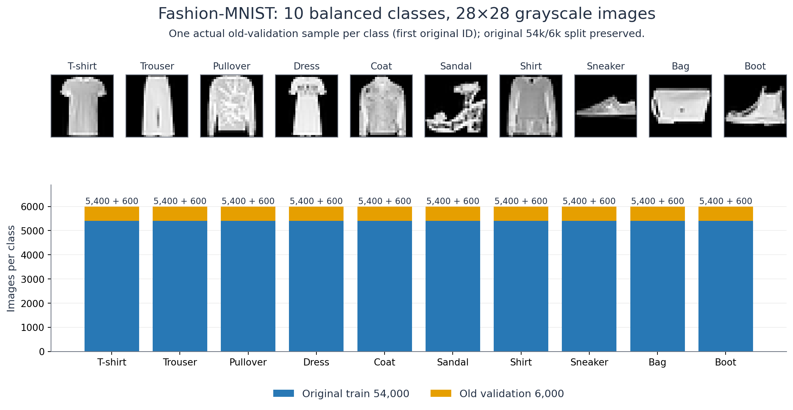
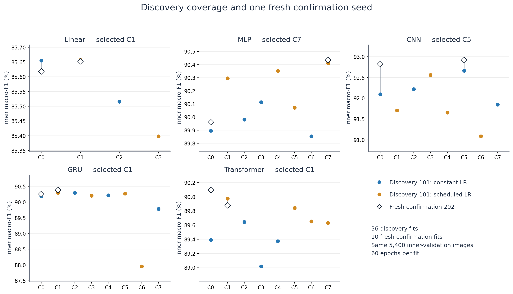
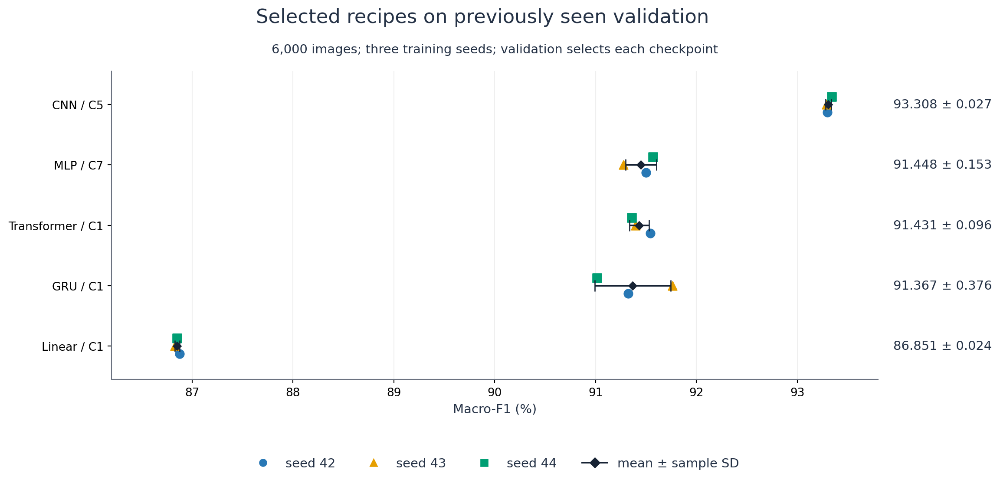
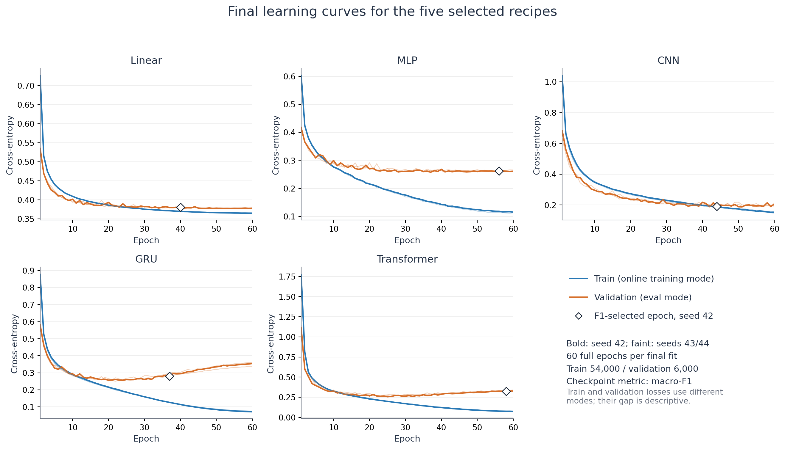
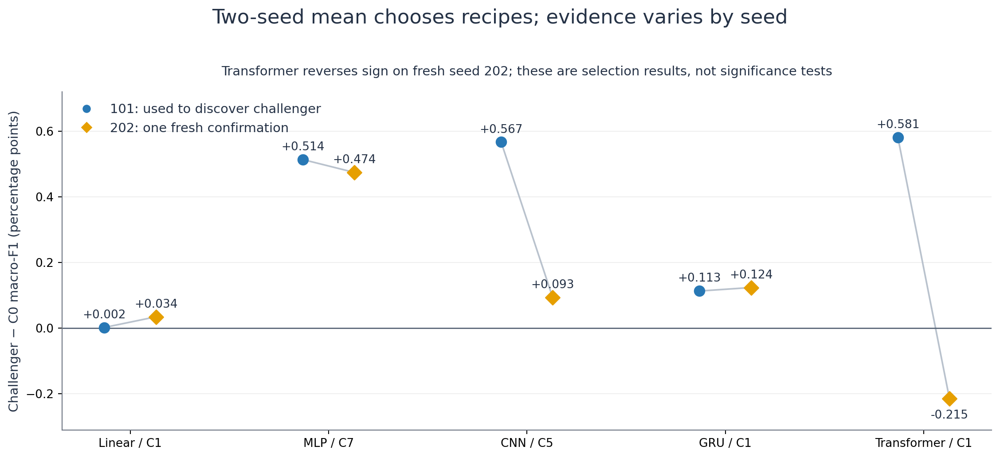
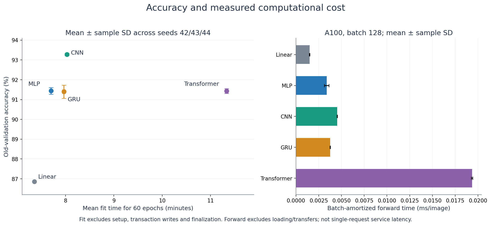
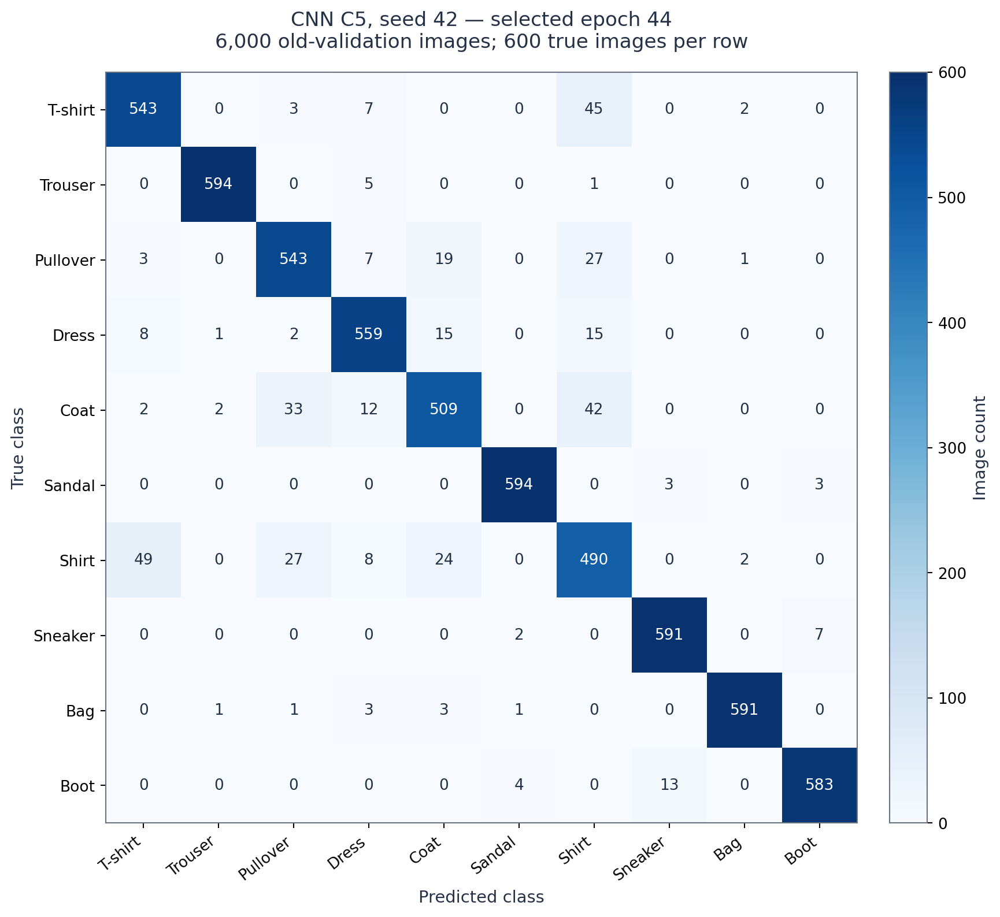
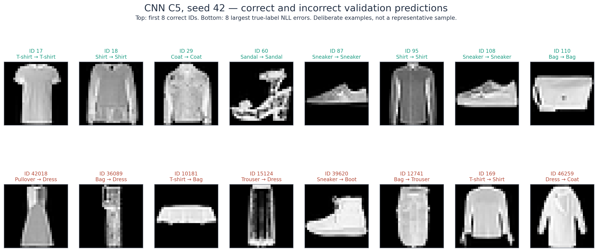

# Assignment 1 · Final study

**From Linear Models to Modern Sequence Models: A Comparative Study for Image Classification**

HCMUT · VNU-HCM · Faculty of Computer Science and Engineering

CO3133 · Semester 261 · Instructor Lê Thành Sách · Group G-M10

Trần Gia Lâm (2352670) · Nguyễn Hữu Cầu (2352129)

**[Read the illustrated study](assignment1-final.html) · [Final report](output/pdf/G-M10_A1_Report_Reviewed_20261104.pdf) · [Source](https://github.com/cau26/CO3133-DLProject)**

## Problem and data

Predict one of ten apparel categories from a 28×28 grayscale Fashion-MNIST image. Inputs are float32 [0,1]; no augmentation or pretrained weights are used. The dataset is class-balanced and distributed by [Zalando Research](https://github.com/zalandoresearch/fashion-mnist) under MIT.

The original training partition is split into 54,000 training and 6,000 validation images with stratification and seed 42. The official 10,000-image test partition stays separate. Recipe discovery uses an inner 48,600/5,400 split drawn exclusively from the original 54,000 training images. Final selected recipes are trained on 54,000 images and checkpoint-selected on the old 6,000 validation images.



## Method and experimental setup

Linear/MLP flatten pixels; CNN extracts spatial features; GRU scans 28 rows; Transformer processes 49 projected patches with positional embeddings and attention. PyTorch provides layers/autograd; this repository implements model composition, data handling, training/evaluation and experiment control.

The fixed Optuna RandomSampler candidate set contains four Linear recipes and eight for each other family. Discovery has 36 tasks with seed 101; confirmation has ten anchor/challenger tasks with fresh seed 202; final fitting has 15 tasks across seeds 42–44. All 61 tasks completed 60 epochs, batch size 128, on A100. The checkpoint criterion is maximum validation macro-F1, then minimum cross-entropy, then earliest epoch. This compares complete recipes; it is not an architecture-only ablation.

| Model | Recipe | Learning rate | Schedule | Weight decay | Dropout |
|---|---|---|---|---|---|
| Linear | C1 | 0.001 | Cosine | 0 | 0 |
| MLP | C7 | 0.00100979 | Cosine | 1e-05 | 0.2 |
| CNN | C5 | 0.00143809 | Constant | 0.0001 | 0.3 |
| GRU | C1 | 0.001 | Cosine | 0.0001 | 0 |
| Transformer | C1 | 0.0005 | Warm-up + cosine | 0.0001 | 0.1 |



## Final exploratory validation

| Model | Recipe | Accuracy (%) mean ± SD | Macro-F1 mean ± SD | Parameters |
|---|---|---|---|---|
| Linear | C1 | 86.8556 ± 0.0096 | 0.86851 ± 0.00024 | 7,850 |
| MLP | C7 | 91.4389 ± 0.1669 | 0.91448 ± 0.00153 | 203,530 |
| CNN | C5 | 93.2778 ± 0.0585 | 0.93308 ± 0.00027 | 93,962 |
| GRU | C1 | 91.4000 ± 0.3279 | 0.91367 ± 0.00376 | 61,962 |
| Transformer | C1 | 91.4333 ± 0.1202 | 0.91431 ± 0.00096 | 274,954 |

These are mean ± sample SD across three training seeds, evaluated on the same checkpoint-selection validation set. They are not new blind test results or confidence intervals.



CNN C5 gives the highest observed mean macro-F1 with 93,962 parameters. GRU is the smallest nonlinear model. The final checkpoint may precede epoch 60; selected CNN epochs are 44, 60 and 55, and GRU epochs are 37, 28 and 34.



## Paired recipe selection

| Model | Selected | Seed 101 ΔF1 (pp) | Fresh seed 202 ΔF1 (pp) | Mean ΔF1 (pp) |
|---|---|---|---|---|
| Linear | C1 | +0.0020 | +0.0344 | +0.0182 |
| MLP | C7 | +0.5136 | +0.4743 | +0.4940 |
| CNN | C5 | +0.5668 | +0.0930 | +0.3299 |
| GRU | C1 | +0.1130 | +0.1236 | +0.1183 |
| Transformer | C1 | +0.5812 | -0.2146 | +0.1833 |

Seed 101 was used to choose the challenger; seed 202 is the only fresh confirmation seed. The Transformer challenger loses on seed 202 but wins the declared two-seed mean rule. This is a locked heuristic, not a significance test or proof of general superiority.



## Cost and errors



Timing uses recorded A100 runs. Forward latency is amortized over batch 128, with ten warm-up and fifty measured forward passes; loading and transfers are excluded. Fit time includes completed train/validation loops and in-memory selection but excludes transaction writes/finalization. The controller recorded 8.34 active hours under a seven-day upper cap.



CNN C5, seed 42, gets 5,597/6,000 old validation images correct. Its largest directed errors include Shirt → T-shirt/top (49/600), T-shirt/top → Shirt (45/600) and Coat → Shirt (42/600). Related silhouettes are a plausible cause to investigate, not a verified explanation.



The example selection uses eight correct predictions in original-ID order and eight errors with the largest supplied true-label NLL. It is illustrative rather than random.

## Original official-test evidence

| Model | Official-test accuracy | Official-test macro-F1 | Parameters |
|---|---|---|---|
| Linear | 84.68% | 0.845902 | 7,850 |
| MLP | 88.74% | 0.886994 | 203,530 |
| CNN | 89.59% | 0.895242 | 93,962 |
| GRU | 89.14% | 0.891450 | 61,962 |
| Transformer | 88.94% | 0.888288 | 274,954 |

These unchanged 20-epoch, seed-42 results use minimum-validation-CE checkpoint selection before freeze and official test. The later optimization has different recipes, engine and checkpoint criterion; its selected validation scores must not be described as test gains.

## Reproduction and materials

- [Final report PDF](output/pdf/G-M10_A1_Report_Reviewed_20261104.pdf)
- [Editable LaTeX project](output/latex/G-M10_A1_Overleaf_Reviewed_20261104.zip)
- [Slides PowerPoint](output/presentation/G-M10_A1_Slides_Reviewed_20261104.pptx) · [Slides PDF](output/presentation/G-M10_A1_Slides_Reviewed_20261104.pdf)
- [Vietnamese presentation script](docs/a1_submission/VIDEO_SCRIPT_REVIEWED_20261104_VI.md)
- [A100 notebook](notebooks/A1_Optimization_A100.ipynb)
- [Reproduction and checkpoint loading](docs/a1_submission/REPRODUCIBILITY_FINAL.md)
- [Verified publication data](output/a1_final/data/publication_data.json)
- [Matched training and prospective RGB audit](confirmatory-results.html)
- [Matched confirmation notebook](notebooks/CO3133_Confirmatory_A100.ipynb)
- [Completed follow-up methods and full tables](docs/a1_extension_research/CONFIRMATORY_RESULTS_20261030.md)
- [GarmentLab controlled-study notebook and recorded results](notebooks/GarmentLab_A100_ImproveToday.ipynb)
- [GarmentLab methods, reproduction and local service](docs/garmentlab/REPRODUCIBILITY.md)

```bash
python -m pip install -r requirements-a1-optimization.txt
python tools/run_a1_optimization.py --stage plan --out outputs/opt3_reproduction --device cuda
python tools/run_a1_optimization.py --stage smoke --out outputs/opt3_reproduction --device cuda
python tools/run_a1_optimization.py --stage run --out outputs/opt3_reproduction --device cuda
python tools/run_a1_optimization.py --stage export --out outputs/opt3_reproduction
```

Use a compatible A100 CUDA runtime. Resume the same run with the same recorded source/environment; use a new output directory for a new experiment. The optimization runner does not open official test data. [Artifact review](verification/OPT3_RETURN_REVIEW_1d2d83edf1dc.md) and [statistics review](verification/OPT3_INDEPENDENT_STATISTICS_1d2d83edf1dc.json) make the records traceable.

## GarmentLab real-image extension

A separate six-class Fashionpedia extension uses pretrained MobileNetV3-Small. Across three paired seeds, fine-tuning records assessment Macro-F1 0.7747 ± 0.0149, compared with 0.6770 ± 0.0055 for a frozen backbone. Assessment has 327 crops from 221 source groups. The frozen review policy gives 92.54% accepted accuracy at 69.72% coverage, below its empirical 95% calibration target.

[Results page](garmentlab-results.html) · [Reproduction and local inference](docs/garmentlab/REPRODUCIBILITY.md) · [Verified extension data](output/garmentlab_final/data/publication_data.json)

The subsequent 20-fit controlled study selected dropout 0.4 (C4) on fresh confirmation seeds. On the reused assessment, its mean Macro-F1 is 0.7664 ± 0.0226, versus 0.7747 ± 0.0149 for the paired C0 anchor; this does not establish a classification gain. A disjoint calibration procedure gives the preset C4 seed314 95.05% accepted accuracy at 55.66% coverage. The statistical risk bound is conditional on assumptions, not a future-accuracy guarantee. The PyTorch CPU demo passes the expanded numerical and service checks. ONNX passes the original 64-case audit but fails the broader 327-crop 1e-4 logit criterion; it remains experimental and is not the primary serving backend.

[Methods and results](output/pdf/G-M10_A1_Report_Reviewed_20261104.pdf) · [Recorded v2 summary](output/garmentlab_improve_return_20261028/FINAL_SUMMARY_V2.json)

## Limits and conclusion

The comparison highlights local features, representation and recipe trade-offs on a small grayscale task. Final validation is previously seen and checkpoint-selected; three seeds describe training variation on one split. Discovery reuse leaves selection bias, and fresh matched final C0 anchors are absent. There is no new blind official test, global-optimum claim or proof that one architecture family is universally better.

## Authors and AI disclosure

AI assisted LaTeX writing and pipeline development. [AI_USAGE.md](AI_USAGE.md).


## Matched follow-up

[Completed matched recipe/checkpoint study and prospective RGB audit](confirmatory-results.html). The primary CNN comparison is inconclusive across the three seed pairs; all prior benchmark tables retain their historical scope.
