# Assignment 2 - M2 Draft & Controlled Experiment

**Deep Learning on Large-Scale Data for Specialized Computer Vision or Language Tasks**

**University:** Ho Chi Minh City University of Technology, VNU-HCM

**Faculty:** Faculty of Computer Science and Engineering

**Course:** Deep Learning and Its Applications - CO3133, Semester 261

**Instructor:** Lê Thành Sách

**Group:** G-M10

| Member | Student ID | Role | Responsibility |
|---|---|---|---|
| Trần Gia Lâm | 2352670 | Leader | Implemented Faster R-CNN ResNet-50-FPN and the backbone freezing vs. full fine-tuning controlled study; ran the Google Colab NVIDIA A100 experiments and 200-step pilots; performed error taxonomy and size-stratified AP analysis; integrated and verified the report |
| Nguyễn Hữu Cầu | 2352129 | Member | Developed and reviewed the PASCAL VOC 2007 task-specific EDA, near-duplicate audit and finalized split (`000863`/`008364`); implemented the SSDLite320 MobileNetV3-Large lightweight baseline and shared VOC2007 11-point evaluator |

**Task Track:** Object Detection (Specialized Computer Vision Task — Handbook Section 16.1)

**Dataset:** PASCAL VOC 2007 (`VOCtrainval_06-Nov-2007.tar`, 20 foreground object categories + 1 background class)

**Scope:** This M2 draft covers task-specific EDA and data quality checks, the finalized leak-free stratified split (`4,014` training / `997` validation images), Dataset/DataLoader and bounding-box coordinate validation, 200-batch + 1-validation-pass compute pilots on an **NVIDIA A100-SXM4-40GB** GPU, a lightweight baseline (`SSDLite320 MobileNetV3-Large`), a stronger pretrained two-stage detector (`Faster R-CNN ResNet-50-FPN`), and a controlled experimental study comparing frozen backbone features against full fine-tuning under identical data, seed, and hyperparameter settings.

**Results:** All pilots and main training runs were executed on **Google Colab with an NVIDIA A100-SXM4-40GB GPU** and evaluated on the same `997` validation images (`2,592` non-difficult ground-truth boxes) using the official PASCAL VOC 2007 11-point interpolated mAP at $\text{IoU} \ge 0.50$. All reported metrics, figures, and error counts come directly from `outputs/a2_m2_a100/` and `../a2_m1/outputs/a2_eda/20261006T225426_686818Z/`. The official VOC2007 test set was not downloaded or evaluated (`test_evaluated = false`).

**Supporting files:** [Formal PDF Report](G-M10_A2_Draft.pdf), [Proposal PDF](../a2_m1/outputs/a2_eda/20261006T225426_686818Z/G-M10_A2_Proposal.pdf), [Executed A100 Colab Notebook](notebooks/A2_Colab_Run.ipynb), [EDA Notebook](../a2_m1/notebooks/A2_EDA_VOC2007.ipynb), [A100 Run Provenance](COLAB_RUN.md), and [AI Usage Disclosure](../../AI_USAGE.md).

---

## Part 1. Problem Formulation, Dataset, and Task-Specific EDA

### 1.1. Problem Statement and Task Definition

Given an arbitrary-resolution RGB photograph $I \in [0, 1]^{3 \times H \times W}$, the object detection model predicts a variable-length set of $N$ candidate detections:

$$\hat{\mathcal{Y}} = \left\{ \left(\hat{\mathbf{b}}_i, \hat{c}_i, \hat{s}_i\right) \right\}_{i=1}^{N}$$

where:
- $\hat{\mathbf{b}}_i = (x_{\min, i}, y_{\min, i}, x_{\max, i}, y_{\max, i}) \in \mathbb{R}^4$ denotes the predicted axis-aligned bounding box in absolute image coordinates with $0 \le x_{\min, i} < x_{\max, i} \le W$ and $0 \le y_{\min, i} < y_{\max, i} \le H$,
- $\hat{c}_i \in \{1, 2, \dots, 20\}$ is the predicted foreground category index across the 20 PASCAL VOC classes (`0` is reserved for background), and
- $\hat{s}_i \in [0, 1]$ is the confidence score associated with detection $i$.

Unlike whole-image classification (Assignment 1), object detection requires joint spatial localization and multi-instance classification across scenes containing multiple overlapping objects, extreme scale variations (from $<1\%$ to $100\%$ of image area), viewpoint changes, truncation, and heavy background clutter.

Our goals in Assignment 2 are:
1. To build an end-to-end, leak-free, reproducible object detection pipeline on PASCAL VOC 2007 with automated coordinate validation and a self-tested VOC 2007 11-point interpolated $\text{mAP}@0.5$ evaluator.
2. To compare a lightweight single-stage mobile detector (**SSDLite320 MobileNetV3-Large**, initialized from ImageNet backbone weights with randomly initialized detection heads) against a two-stage Feature Pyramid detector (**Faster R-CNN ResNet-50-FPN**, initialized from `COCO_V1` detection weights with a newly initialized 21-class predictor head).
3. To conduct a **controlled experiment** isolating the effect of **backbone freezing vs. full end-to-end fine-tuning** in Faster R-CNN ResNet-50-FPN while holding the dataset split, random seed (`42`), initial weights, optimizer, learning rate schedule, batch size, and evaluation protocol strictly fixed.

### 1.2. Dataset Source, Provenance, and Split Finalization

We use the official **PASCAL Visual Object Classes Challenge 2007 (VOC2007)** development archive `VOCtrainval_06-Nov-2007.tar` [1]:
- **Archive size and checksum:** `460,032,000` bytes (`438.72 MB`), MD5 `c52e279531787c972589f7e41ab4ae64`, SHA-256 `7d8639bf11eb20ef20fc8cfe6fb6fd1ef3fd0a5f0f2f08f891b86d78e702cb73`.
- **Usage terms:** Used strictly for academic instruction and research in accordance with the PASCAL VOC Database Rights statement and Flickr image terms of use.
- **Scope and subsampling policy:** All `5,011` images and `15,662` XML bounding-box annotations in the official `trainval` pool are retained (`12,608` non-difficult objects and `3,054` objects marked `difficult=1`). No image-level subsampling was performed. The official test set is reserved and was not downloaded or evaluated during M1 or M2.

#### Resolving the M1 Cross-Split Near-Duplicate Before Main Training

During the M1 preliminary EDA, multi-label iterative stratification (`seed = 42`, 80/20 ratio) produced an initial split of `4,013` training and `998` validation images. However, our perceptual hash (`dHash` + `aHash`) audit identified a true cross-split near-duplicate pair:
- Image `000863` (originally placed in `val`) and image `008364` (in `train`), with `dHash` distance $= 3$ and `aHash` distance $= 2$, both depicting the same coastal boat scene (`boat` class, `2` non-difficult boxes and `2` difficult boxes).

Before running any M2 training or pilot experiments, we grouped `000863` with `008364` inside the training split and synchronized all split manifests ([`splits/train.txt`](splits/train.txt), [`splits/val.txt`](splits/val.txt), [`splits/trainval_source.txt`](splits/trainval_source.txt)). The finalized leak-free partition has SHA-256 fingerprint `c60294fe4e914b27399ff065c9e246dcd3428440307c97cebf2febe139c2bd6c` and zero cross-split duplicate or near-duplicate pairs:

| Finalized Split | Images | Total Annotated Boxes | Non-Difficult Boxes (`difficult=0`) | Difficult Boxes (`difficult=1`) | Cross-Split Near-Duplicates |
|---|---:|---:|---:|---:|---:|
| Official `trainval` pool | 5,011 | 15,662 | 12,608 | 3,054 | — |
| **Finalized Training (`splits/train.txt`)** | **4,014** | **12,451** | **10,016** | **2,435** | **0** |
| **Finalized Validation (`splits/val.txt`)** | **997** | **3,211** | **2,592** | **619** | **0** |

Per the official VOC 2007 protocol and our training pipeline (`a2/data.py`), training uses the `10,016` valid non-difficult boxes across the `4,014` training images, while validation evaluates against all `3,211` validation annotations across the `997` validation images—scoring True/False Positives against the `2,592` non-difficult ground-truth boxes and ignoring detections that match the `619` `difficult=1` boxes so models are neither penalized nor rewarded for ambiguous/heavily occluded instances.

### 1.3. Task-Specific Exploratory Data Analysis (EDA)

All seven EDA visual checks and tables were generated from the `5,011` `trainval` images (`../a2_m1/outputs/a2_eda/20261006T225426_686818Z/`) and updated below to reflect the finalized `4,014` / `997` split.

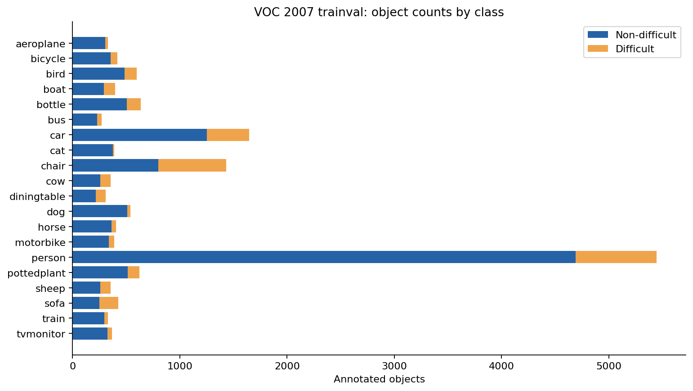

1. **Severe Class Imbalance (Figure 1):** Across the `12,608` non-difficult boxes in `trainval`, `person` dominates with `4,690` instances (`3,748` train / `942` val), followed by `car` (`1,250` total: `988` train / `262` val) and `chair` (`798` total: `632` train / `166` val). By contrast, the rarest categories have fewer than 250 non-difficult instances: `diningtable` (`215` total: `173` train / `42` val), `bus` (`213` total: `171` train / `42` val), `sofa` (`248` total: `201` train / `47` val), and `sheep` (`257` total: `205` train / `52` val). The largest-to-smallest foreground class ratio is **$22.02 : 1$** (`person` vs. `bus`). Because our primary metric (`mAP@0.5`) weights all 20 classes equally, poor recall on rare classes directly depresses overall mAP.

| Class ID | Category | Train Images | Val Images | Train Boxes (`diff=0`) | Val Boxes (`diff=0`) | Train Boxes (`diff=1`) | Val Boxes (`diff=1`) | Val Share of Class Boxes |
|---:|---|---:|---:|---:|---:|---:|---:|---:|
| 1 | `aeroplane` | 190 | 48 | 237 | 69 | 19 | 6 | 22.55% |
| 2 | `bicycle` | 194 | 49 | 269 | 84 | 54 | 11 | 23.80% |
| 3 | `bird` | 264 | 66 | 401 | 98 | 78 | 22 | 19.64% |
| 4 | `boat` | 146 | 35 | 224 | 67 | 80 | 27 | 23.02% |
| 5 | `bottle` | 195 | 49 | 408 | 97 | 113 | 17 | 19.21% |
| 6 | `bus` | 149 | 37 | 171 | 42 | 47 | 12 | 19.72% |
| 7 | `car` | 571 | 142 | 988 | 262 | 316 | 75 | 20.96% |
| 8 | `cat` | 270 | 67 | 314 | 75 | 28 | 5 | 19.28% |
| 9 | `chair` | 356 | 89 | 632 | 166 | 510 | 124 | 20.80% |
| 10 | `cow` | 113 | 28 | 204 | 55 | 38 | 6 | 21.24% |
| 11 | `diningtable` | 160 | 40 | 173 | 42 | 82 | 13 | 19.53% |
| 12 | `dog` | 337 | 84 | 413 | 97 | 50 | 11 | 19.02% |
| 13 | `horse` | 230 | 57 | 293 | 69 | 36 | 8 | 19.06% |
| 14 | `motorbike` | 196 | 49 | 276 | 63 | 39 | 12 | 18.58% |
| 15 | `person` | 1,605 | 403 | 3,748 | 942 | 634 | 170 | 20.09% |
| 16 | `pottedplant` | 196 | 49 | 374 | 140 | 95 | 16 | 27.24% |
| 17 | `sheep` | 77 | 19 | 205 | 52 | 66 | 30 | 20.23% |
| 18 | `sofa` | 183 | 46 | 201 | 47 | 142 | 35 | 18.95% |
| 19 | `train` | 209 | 52 | 236 | 61 | 29 | 6 | 20.54% |
| 20 | `tvmonitor` | 205 | 51 | 249 | 64 | 69 | 13 | 20.45% |
| **Total** | **All 20 classes** | **4,014** | **997** | **10,016** | **2,592** | **2,435** | **619** | **20.56%** |

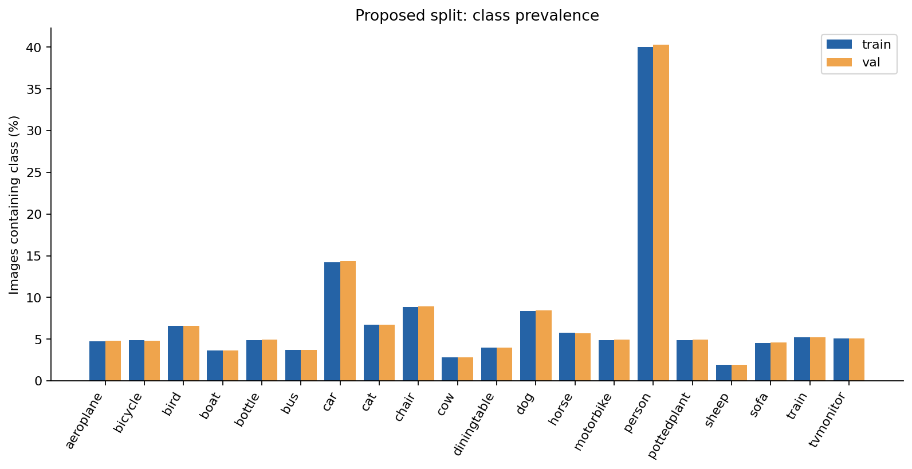

2. **Multi-Label Stratification Fidelity (Figure 2):** Image-level presence ratios are tightly preserved between training and validation across all 20 classes (close to the target $80\% / 20\%$ split), ensuring that validation mAP reflects performance on the same class distribution as training.

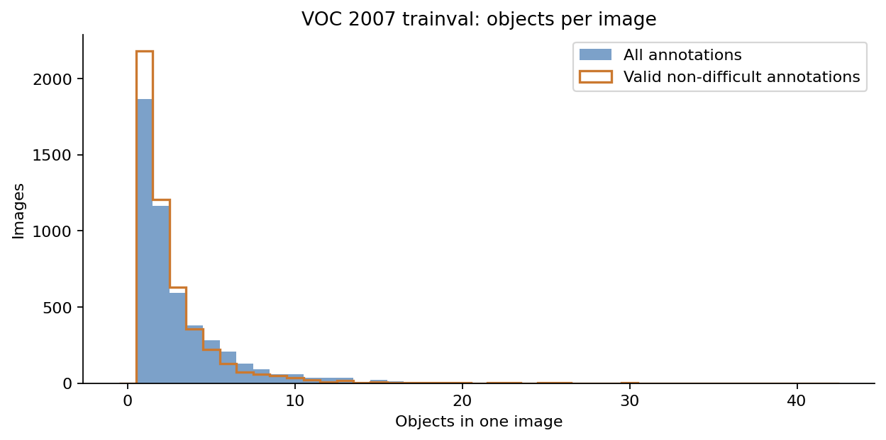

3. **Multi-Object Density and Crowding (Figure 3):** Counting all annotations, images contain a mean of `3.13` objects (median `2`, 90th percentile `6`, maximum `42`). Counting only non-difficult objects, images average `2.52` objects (median `2`, 90th percentile `5`, maximum `37`), and `36` training images (`8` validation images) contain only `difficult=1` annotations (`0` non-difficult objects). Our dataset pipeline retains these images with empty target tensors `(0, 4)` so detectors also learn to suppress false positives on ambiguous scenes.

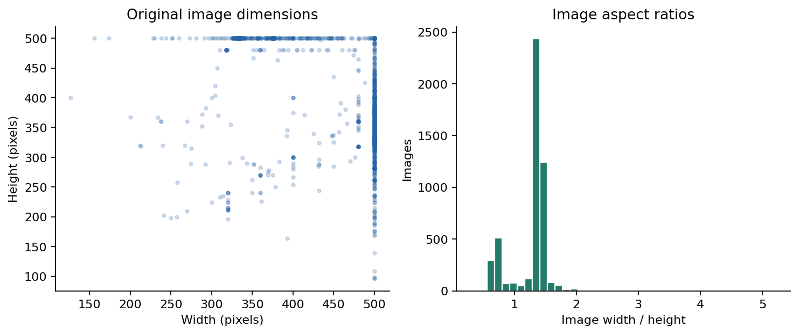

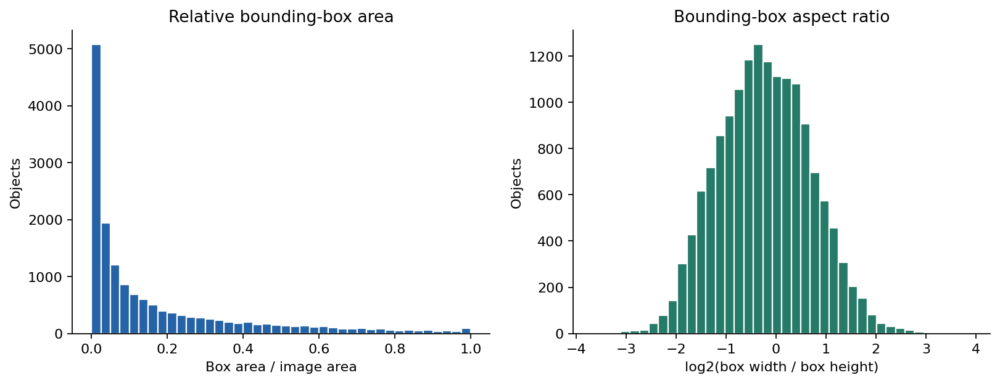

4. **Image Resolutions and Bounding-Box Geometry (Figures 4–5):** Image widths span `174`–`500` px (median `500` px) and heights span `96`–`500` px (median `375` px). Across the `12,608` non-difficult boxes, relative box area (box area divided by image area) has a median of `9.74%` (IQR `2.70%` to `26.86%`, min `0.036%`, max `100.0%`). Crucially:
   - **Small boxes (`< 2%` of image area):** `2,597` boxes (`20.60%` of all non-difficult annotations).
   - **Medium boxes (`2%` to `< 15%` of image area):** `4,782` boxes (`37.93%`).
   - **Large boxes (`>= 15%` of image area):** `5,229` boxes (`41.47%`).
   - **EDA Hypothesis for Model Comparison:** Because `SSDLite320` warps every input image to a fixed $320 \times 320$ resolution before feature extraction, an object occupying $<2\%$ of a $500 \times 375$ image shrinks to fewer than $45 \times 45$ pixels (and $<3\times 3$ cells on coarse feature maps). In contrast, `Faster R-CNN ResNet-50-FPN` scales the shorter image side to `800` px (up to `1,333` px on the longer side) and extracts multi-scale features via a Feature Pyramid Network (`P2`–`P6`). We therefore hypothesize that `Faster R-CNN` will show its largest relative gain over `SSDLite320` on **small (`<2%` area) and medium (`2–15%` area) objects**, and on small-object-heavy classes such as `bottle`, `pottedplant`, `bird`, and `boat`.

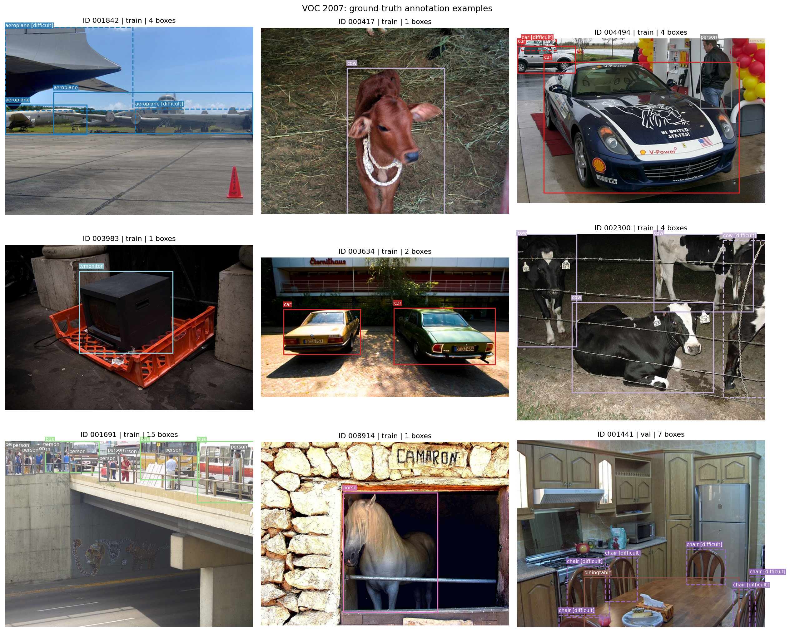

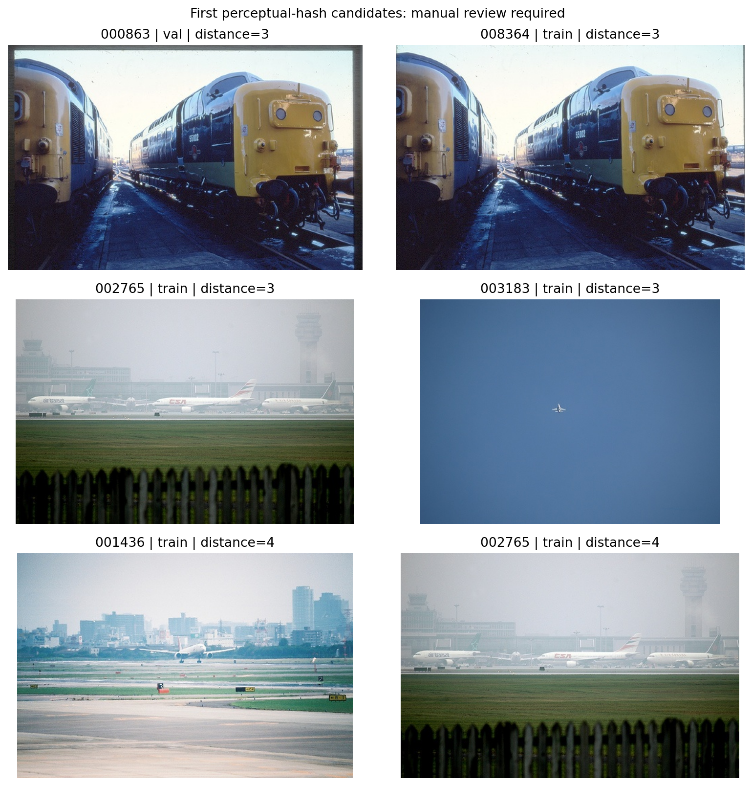

5. **Automated Annotation Integrity and Duplicate Checks (Figures 6–7):** In [`../a2_m1/outputs/a2_eda/20261006T225426_686818Z/quality_checks.json`](../a2_m1/outputs/a2_eda/20261006T225426_686818Z/quality_checks.json), all `5,011` images and `15,662` boxes passed structural verification: `missing_image_files = 0`, `unreadable_images = 0`, `xml_parse_errors = 0`, `unknown_class_boxes = 0`, `non_positive_boxes_after_clip = 0`, and `out_of_bounds_boxes_before_clip = 0`. Converting 1-based inclusive VOC XML coordinates `(xmin, ymin, xmax, ymax)` to 0-based coordinates clipped to image bounds adjusts `556` boundary-touching boxes (`1.0` px offset) without losing any valid instances. All `7` exact-duplicate groups (`14` images) and the confirmed near-duplicate pair (`000863`/`008364`) are strictly confined within single splits (`cross_split_near_duplicate_candidates = 0`).

### 1.4. Preprocessing, Dataset, and DataLoader Inspection

Our data pipeline in [`a2/data.py`](a2/data.py) implements `VOCDetectionDataset`, which reads the finalized split manifests (`splits/train.txt` and `splits/val.txt`), parses the VOC XML annotations, converts bounding boxes to `torch.float32` tensors in `[xmin, ymin, xmax, ymax]` format, and verifies on every sample that $x_{\max} > x_{\min}$ and $y_{\max} > y_{\min}$.
- **Image conversion:** RGB `uint8` images in `[0, 255]` are converted to `torch.float32` tensors in `[0.0, 1.0]` with shape `(3, H, W)`. Internal model transforms (`GeneralizedRCNNTransform` for Faster R-CNN and `SSDTransform` for SSDLite320) handle model-specific resizing and ImageNet normalization (`mean = [0.485, 0.456, 0.406]`, `std = [0.229, 0.224, 0.225]`).
- **Training augmentation (`HorizontalFlipWithBoxes`):** During training only, images and their bounding boxes undergo random horizontal flipping with probability $p = 0.5$ using a deterministic transformation $x'_{\min} = W - x_{\max}$, $x'_{\max} = W - x_{\min}$, followed by an explicit coordinate validity assertion (`assert torch.all(boxes[:, 2] > boxes[:, 0])`). No augmentation is applied during validation.
- **Collation and DataLoader seeding:** Because detection images have variable dimensions $(3, H_i, W_i)$ and variable numbers of ground-truth boxes $(M_i, 4)$, `detection_collate_fn` collates each batch into a tuple `(list[Tensor], list[dict])`. Training DataLoaders shuffle using a `torch.Generator` seeded at `42 + model_offset` (`num_workers = 2`, `pin_memory = True` on CUDA); validation DataLoaders run deterministically with `shuffle = False`.

Before training on the Google Colab A100 runtime, the pipeline inspected and saved the first training batch in [`outputs/a2_m2_a100/eda/batch_info.json`](outputs/a2_m2_a100/eda/batch_info.json) and rendered [`outputs/a2_m2_a100/eda/batch_preview.png`](outputs/a2_m2_a100/eda/batch_preview.png):
- **Batch size:** `8` images (image IDs `000005`, `000007`, `000009`, `000012`, `000016`, `000017`, `000019`, `000020`).
- **Inspected tensor shapes:** `[(3, 375, 500), (3, 333, 500), (3, 375, 500), (3, 333, 500), (3, 500, 334), (3, 364, 480), (3, 375, 500), (3, 500, 375)]`.
- **Data type and range:** `torch.float32`, `pixel_min = 0.0`, `pixel_max = 1.0`.
- **Target non-difficult box counts in batch:** `[3, 1, 4, 1, 1, 2, 2, 1]`.

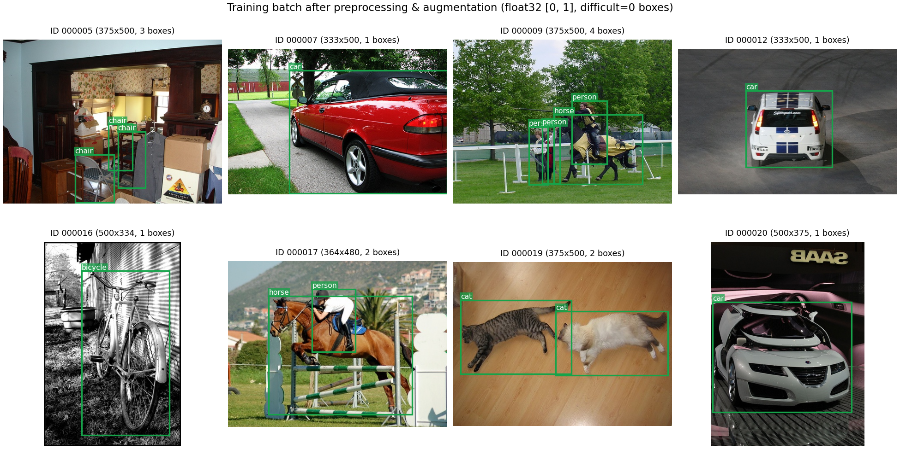

---

## Part 2. Methodology, Pilot Profiling, and Experimental Design

### 2.1. Pipeline Architecture and Models Compared

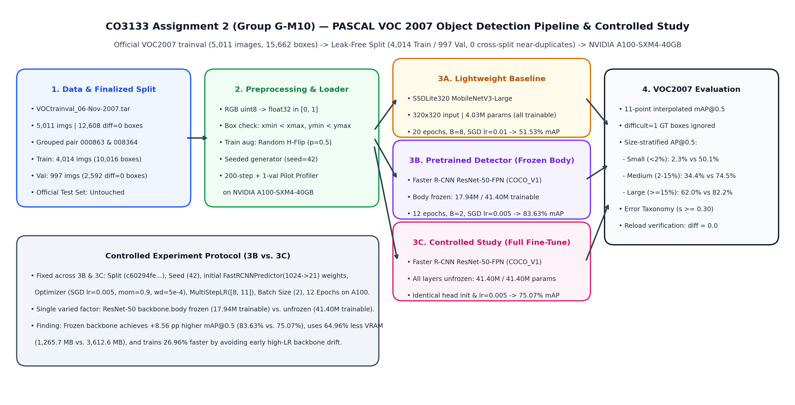

Our pipeline in [`a2/models.py`](a2/models.py), [`a2/train.py`](a2/train.py), and [`a2/voc_eval.py`](a2/voc_eval.py) compares three model configurations across two architectural families:

| Configuration ID | Architectural Family | Backbone & Pretraining | Detection Head Adaptation | Total Parameters | Trainable Parameters | Frozen Parameters |
|---|---|---|---|---:|---:|---:|
| **`ssdlite320`** | Single-stage anchor detector (`SSDLite320`) | MobileNetV3-Large (`IMAGENET1K_V1` backbone weights) | Depthwise-separable `SSDLiteHead` initialized from scratch for `21` classes ($320 \times 320$ input) | 4,026,740 | 4,026,740 (100.0%) | 0 |
| **`fasterrcnn_frozen`** | Two-stage FPN detector (`Faster R-CNN`) | ResNet-50-FPN (`COCO_V1` detector weights; **ResNet-50 body frozen**) | `FastRCNNPredictor(1024 -> 21)` replaced & seeded identically (`seed=42`); FPN + RPN + RoI heads trained | 41,396,536 | 17,941,624 (43.34%) | 23,454,912 (56.66%) |
| **`fasterrcnn_finetune`** | Two-stage FPN detector (`Faster R-CNN`) | ResNet-50-FPN (`COCO_V1` detector weights; **all layers trainable**) | Identical `FastRCNNPredictor(1024 -> 21)` initialization (`seed=42`); full end-to-end fine-tuning | 41,396,536 | 41,396,536 (100.0%) | 0 |

#### Architectural Contrast
1. **`ssdlite320` (Lightweight Baseline):** Resizes every input image to $320 \times 320$ and passes it through a MobileNetV3-Large backbone coupled with depthwise-separable convolutional feature pyramids (`SSDLiteFeatureExtractorMobileNet`). Across 6 feature map scales, it predicts class logits (`21` classes) and bounding-box offsets directly from default anchor boxes in a single forward pass without region proposal refinement.
2. **`fasterrcnn_frozen` and `fasterrcnn_finetune` (Pretrained Two-Stage Detector & Controlled Study):** Scales the shorter image dimension to `800` px (capped at `1,333` px on the longer side) and extracts hierarchical multi-scale feature maps (`P2`, `P3`, `P4`, `P5`, `P6`) via a ResNet-50 backbone and Feature Pyramid Network (FPN). A Region Proposal Network (RPN) generates objectness scores and coarse proposals across scales; `MultiScaleRoIAlign` crops $7 \times 7$ feature maps per proposal; and a two-layer MLP (`TwoMLPHead`, representation size `1,024`) feeds `FastRCNNPredictor` to output `21`-class classification logits and class-specific bounding-box regressions.

### 2.2. Controlled Experiment Design: Backbone Freezing vs. Full Fine-Tuning

To satisfy the Course Project Handbook requirement for a **controlled scientific experiment** (Sections 3.2 and 19), we compare `fasterrcnn_frozen` and `fasterrcnn_finetune` by varying **exactly one factor**—whether the pretrained ResNet-50 backbone body (`model.backbone.body`, `23,454,912` parameters) is frozen (`requires_grad = False`) or unfrozen (`requires_grad = True` across `layer1`–`layer4`, matching `trainable_backbone_layers = 5`)—while holding all other experimental variables strictly constant:
- **Identical Data & Ordering:** Same `4,014` training and `997` validation images (`split_sha256 = c60294fe4e914b27399ff065c9e246dcd3428440307c97cebf2febe139c2bd6c`).
- **Identical Pretrained Initialization & New Head Weights:** Both models start from `FasterRCNN_ResNet50_FPN_Weights.COCO_V1` and reset the random seed (`set_seed(42)`) immediately before instantiating `FastRCNNPredictor(in_features=1024, num_classes=21)`, ensuring bitwise-identical initial weights in the new 21-class classification and box-regression head.
- **Identical Optimizer & Schedule:** SGD with learning rate `0.005`, momentum `0.9`, weight decay `0.0005`, gradient clipping (`max_norm = 10.0`), `MultiStepLR` milestones at epochs `[8, 11]` (`gamma = 0.1`), batch size `2`, and `12` epochs on the same NVIDIA A100-SXM4-40GB GPU.
- **Hypothesis under test:** While full fine-tuning offers higher representational flexibility (`41.40M` vs. `17.94M` trainable parameters), applying a uniform initial learning rate (`lr = 0.005`) with a small detection batch size ($B = 2$) and no warmup simultaneously to a randomly initialized `FastRCNNPredictor` head and a pretrained ResNet-50 backbone can propagate large early gradients into the backbone, destabilizing pretrained `COCO_V1` features and increasing memory/runtime cost. Freezing the ResNet-50 body while adapting the FPN (`P2`–`P6`), RPN, and RoI heads (`17.94M` parameters) should preserve spatial feature quality, train faster, use significantly less VRAM, and achieve stronger validation generalization under this fixed hyperparameter budget.

### 2.3. 200-Batch + 1-Validation-Pass Compute Pilots on NVIDIA A100

Before executing the full multi-epoch runs, our pipeline ran an automated **200-batch training + 1-full-validation-pass pilot** (`run_a2.py --stage pilot`) on the **NVIDIA A100-SXM4-40GB** GPU (`outputs/a2_m2_a100/pilots/`) to empirically profile step times, validation latency, peak GPU memory, and early convergence, and to verify that the full experiment fits well within the M1 30 GPU-hour compute budget:

| Pilot Model | Batch Size | Steps / Epoch | Measured $t_{\text{step}}$ (ms) | Measured $t_{\text{val}}$ (s) | Pilot Train Loss (200 steps) | Pilot Val mAP@0.5 | Peak VRAM (MB) | Planned Epochs | Projected Full Runtime | Actual Full Fit Wall Time |
|---|---:|---:|---:|---:|---:|---:|---:|---:|---:|---:|
| **`ssdlite320`** | 8 | 502 | 110.92 | 15.71 | 8.1243 | 8.81% | 462.6 | 20 | 23.80 min (1,427.9 s) | **17.90 min (1,074.1 s)** |
| **`fasterrcnn_frozen`** | 2 | 2,007 | 77.55 | 22.68 | 0.5798 | 65.02% | 1,238.1 | 12 | 35.67 min (2,140.0 s) | **26.13 min (1,567.6 s)** |
| **`fasterrcnn_finetune`** | 2 | 2,007 | 84.98 | 20.71 | 0.6450 | 35.81% | 3,325.9 | 12 | 38.25 min (2,295.1 s) | **34.22 min (2,053.1 s)** |

Sources: [`ssdlite320_pilot.json`](outputs/a2_m2_a100/pilots/ssdlite320_pilot.json), [`fasterrcnn_frozen_pilot.json`](outputs/a2_m2_a100/pilots/fasterrcnn_frozen_pilot.json), and [`fasterrcnn_finetune_pilot.json`](outputs/a2_m2_a100/pilots/fasterrcnn_finetune_pilot.json).

**Key Pilot Insights:**
1. **Compute Budget Verification:** The three pilots confirmed that all three main runs plus pilots require approximately **1.4 GPU-hours total** on an NVIDIA A100-SXM4-40GB—well below our 30 GPU-hour planning ceiling. Based on the rapid convergence of `COCO_V1`-initialized Faster R-CNN in the pilot (`65.02%` mAP@0.5 after just 200 batches for `fasterrcnn_frozen`), we set the Faster R-CNN training schedule to `12` epochs with LR decays at epochs `8` and `11`, while keeping `20` epochs (LR decays at epochs `12` and `16`) for `ssdlite320` whose detection head is initialized from scratch.
2. **Early Evidence of the Controlled Experiment Effect:** Even after just `200` training steps (`400` images at $B=2$), `fasterrcnn_frozen` reached **`65.02%`** validation mAP@0.5 (`pilot_loss = 0.5798`), whereas `fasterrcnn_finetune` reached only **`35.81%`** validation mAP@0.5 (`pilot_loss = 0.6450`) while consuming **`2.69x` more VRAM** (`3,325.9 MB` vs. `1,238.1 MB`). This immediately corroborated our hypothesis that early gradients from the newly initialized 21-class head perturb the unfrozen ResNet-50 backbone at `lr = 0.005`.

### 2.4. Training Protocol, Evaluation Metrics, and Evaluator Verification

| Protocol Setting | `ssdlite320` | `fasterrcnn_frozen` | `fasterrcnn_finetune` |
|---|---|---|---|
| **Dataset & Split** | Finalized VOC2007 (`4,014` train / `997` val, `seed = 42`) | Same (`c60294fe...`) | Same (`c60294fe...`) |
| **Optimizer** | SGD (`lr = 0.01`, `momentum = 0.9`, `weight_decay = 0.0005`) | SGD (`lr = 0.005`, `momentum = 0.9`, `weight_decay = 0.0005`) | SGD (`lr = 0.005`, `momentum = 0.9`, `weight_decay = 0.0005`) |
| **LR Scheduler** | `MultiStepLR(milestones=[12, 16], gamma=0.1)` | `MultiStepLR(milestones=[8, 11], gamma=0.1)` | `MultiStepLR(milestones=[8, 11], gamma=0.1)` |
| **Batch Size / Epochs** | `8` / `20` (`502` steps/epoch) | `2` / `12` (`2,007` steps/epoch) | `2` / `12` (`2,007` steps/epoch) |
| **Gradient Clipping** | `clip_grad_norm_(max_norm = 10.0)` | `clip_grad_norm_(max_norm = 10.0)` | `clip_grad_norm_(max_norm = 10.0)` |
| **Training Losses** | Multibox focal/smooth-$L_1$ (`classification` + `bbox_regression`) | `loss_classifier` + `loss_box_reg` + `loss_objectness` + `loss_rpn_box_reg` | `loss_classifier` + `loss_box_reg` + `loss_objectness` + `loss_rpn_box_reg` |
| **Checkpoint Selection** | Highest validation `mAP@0.5` (`best.pt`) | Highest validation `mAP@0.5` (`best.pt`) | Highest validation `mAP@0.5` (`best.pt`) |
| **Hardware & Software** | Google Colab, **NVIDIA A100-SXM4-40GB** (`39.49 GB` VRAM), CUDA `13.0`, Python `3.13.16`, PyTorch `2.11.0+cu130`, Torchvision `0.26.0+cu130` | Same | Same |

#### Evaluation Metrics (`a2/voc_eval.py`)
1. **Primary Metric — VOC 2007 11-Point Interpolated $\text{mAP}@0.5$:** For each of the 20 foreground classes, detections across all `997` validation images are sorted by descending confidence score $\hat{s}_i$. A detection is assigned as a **True Positive (TP)** if its Intersection-over-Union ($\text{IoU}$) with an unmatched non-difficult ground-truth box of the same class satisfies $\text{IoU} \ge 0.50$. Detections matching a `difficult=1` ground-truth box with $\text{IoU} \ge 0.50$ are marked `ignore` (neither TP nor FP). Multiple detections matching the same ground-truth box are counted as **False Positives (FP)**. From the cumulative precision $P(k)$ and recall $R(k)$ curve, the 11-point interpolated Average Precision is:

$$\text{AP}_{11} = \frac{1}{11} \sum_{r \in \{0.0, 0.1, \dots, 1.0\}} \max_{\tilde{r} \ge r} P(\tilde{r}), \qquad \text{mAP}@0.5 = \frac{1}{20} \sum_{c=1}^{20} \text{AP}_{11, c}$$

2. **Size-Stratified $\text{AP}@0.5$ (`small`, `medium`, `large`):** To test our EDA scale hypothesis directly, [`a2/voc_eval.py`](a2/voc_eval.py) also computes size-stratified $\text{mAP}@0.5$ by evaluating each size bucket (`small`: relative box area $< 2\%$, `medium`: $2\%$–$15\%$, `large`: $\ge 15\%$) while treating ground-truth boxes outside the active size bucket as `difficult=1` (ignored), so detections on medium/large objects are not falsely penalized as FPs when measuring small-object AP.
3. **Unit Self-Test:** Before any training or evaluation run, `self_test_voc_evaluator()` in [`a2/voc_eval.py`](a2/voc_eval.py) executes an analytic unit test verifying `AP = 1.0` for perfect detections, `difficult=1` ignore semantics, and duplicate-box FP penalty (`expected_ap = 6/11 = 0.545455`).

---

## Part 3. Experimental Results, Analysis, and Discussion

### 3.1. Overall Quantitative Results at Selected Checkpoints

| Model | Best Epoch | Train Loss (Best) | **Val mAP@0.5** | **AP@0.5 Small (`<2%`)** | **AP@0.5 Medium (`2–15%`)** | **AP@0.5 Large (`>=15%`)** | Trainable / Total Params | Train Time (s) | Val Time (s) | Fit Wall (s) | Latency (ms/img) | Throughput (FPS) | Peak VRAM (MB) |
|---|---:|---:|---:|---:|---:|---:|---:|---:|---:|---:|---:|---:|---:|
| **`ssdlite320`** | 18 / 20 | 2.3709 | **51.53%** (`0.5153`) | **2.29%** (`0.0229`) | **34.36%** (`0.3436`) | **61.96%** (`0.6196`) | 4.03M / 4.03M | 832.30 | 238.71 | 1,074.08 | **16.62** | **60.17** | **462.8** |
| **`fasterrcnn_frozen`** | 12 / 12 | 0.1763 | **83.63%** (`0.8363`) | **50.08%** (`0.5008`) | **74.51%** (`0.7451`) | **82.24%** (`0.8224`) | 17.94M / 41.40M | 1,320.33 | 239.10 | 1,567.55 | 29.28 | 34.15 | 1,265.7 |
| **`fasterrcnn_finetune`** | 10 / 12 | 0.1503 | **75.07%** (`0.7507`) | **42.14%** (`0.4214`) | **62.14%** (`0.6214`) | **73.95%** (`0.7395`) | 41.40M / 41.40M | 1,807.59 | 237.13 | 2,053.11 | 22.03 | 45.40 | 3,612.6 |

Sources: [`outputs/a2_m2_a100/comparison.csv`](outputs/a2_m2_a100/comparison.csv), [`ssdlite320/metrics.json`](outputs/a2_m2_a100/ssdlite320/metrics.json), [`fasterrcnn_frozen/metrics.json`](outputs/a2_m2_a100/fasterrcnn_frozen/metrics.json), and [`fasterrcnn_finetune/metrics.json`](outputs/a2_m2_a100/fasterrcnn_finetune/metrics.json). All three saved `best.pt` checkpoints were reloaded in `run_a2.py --stage evaluate` and verified to match their saved `val_map50` to `0.000000` difference in [`checkpoint_verification.json`](outputs/a2_m2_a100/ssdlite320/checkpoint_verification.json).

**Summary of Main Findings:**
1. **Pretrained Two-Stage FPN vs. Lightweight Single-Stage Baseline:** `fasterrcnn_frozen` outperforms `ssdlite320` by **`+32.10` percentage points** in overall validation `mAP@0.5` (`83.63%` vs. `51.53%`).
2. **Confirmation of the EDA Scale Hypothesis:** While `ssdlite320` achieves respectable accuracy on large objects covering $\ge 15\%$ of the image (`61.96%` AP@0.5 vs. `82.24%` for `fasterrcnn_frozen`), its performance collapses on medium objects (`34.36%` vs. `74.51%`, a **`-40.15` pp** gap) and almost completely fails on small objects occupying $<2\%$ of the image (**`2.29%`** vs. **`50.08%`**, a **`-47.79` pp** gap). This directly validates our Part 1.3 geometric analysis: downsampling images to $320 \times 320$ without a multi-scale Feature Pyramid Network destroys spatial resolution for the `20.60%` of VOC2007 objects that occupy $<2\%$ of image area.
3. **Controlled Study Outcome (`fasterrcnn_frozen` vs. `fasterrcnn_finetune`):** Holding the dataset split, initial `FastRCNNPredictor` weights, seed (`42`), batch size (`2`), and SGD schedule (`lr = 0.005`) constant, freezing the ResNet-50 body (`fasterrcnn_frozen`) outperforms full fine-tuning (`fasterrcnn_finetune`) by **`+8.56` percentage points** in validation `mAP@0.5` (`83.63%` vs. `75.07%`), while reducing training time by **`26.96%`** (`1,320.3 s` vs. `1,807.6 s`) and reducing peak GPU memory by **`64.96%`** (`1,265.7 MB` vs. `3,612.6 MB`).

### 3.2. Learning Curves and Training Dynamics

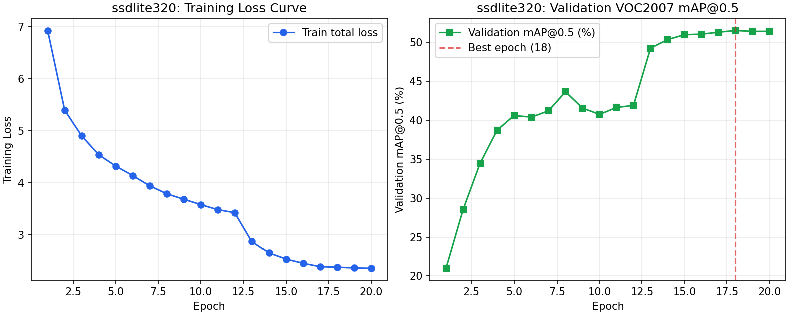

1. **`ssdlite320` Dynamics (Figure 10, [`ssdlite320/history.csv`](outputs/a2_m2_a100/ssdlite320/history.csv)):** Starting from randomly initialized detection heads at `lr = 0.01`, training loss drops from `6.9270` (`bbox = 2.0798`, `cls = 4.8472`) at epoch 1 (`val_map50 = 20.98%`) to `3.4215` at epoch 12 (`val_map50 = 41.91%`). Between epochs 8 and 12 at constant `lr = 0.01`, validation mAP plateaus around `40.76%`–`43.67%`. When `MultiStepLR` reduces the learning rate $10\times$ to `0.001` at epoch 13, validation `mAP@0.5` jumps immediately by **`+7.35` percentage points** in a single epoch (from `41.91%` to `49.26%`), and reaches its peak of **`51.53%`** at **epoch 18** (`lr = 0.0001`, `train_loss = 2.3709`). Throughout all 20 epochs, `val_map50_small` never exceeds `2.46%`, proving that the small-object bottleneck is architectural (fixed $320 \times 320$ resolution) rather than an under-training artifact.

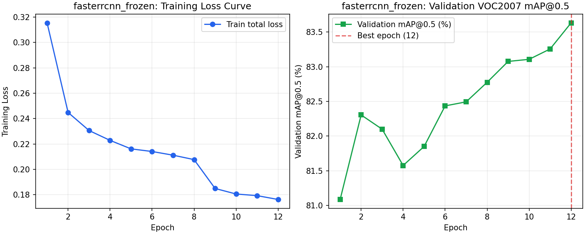

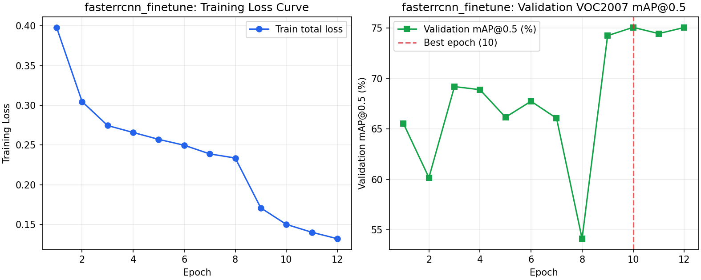

2. **Controlled Study Dynamics — Why Full Fine-Tuning Degrades Under Uniform High LR (Figures 11–12):**
   - In **`fasterrcnn_frozen`** ([`fasterrcnn_frozen/history.csv`](outputs/a2_m2_a100/fasterrcnn_frozen/history.csv)), freezing the ResNet-50 body keeps the pretrained features stable while the FPN, RPN, and new 21-class RoI head adapt smoothly: `val_map50` starts at **`81.09%`** at epoch 1 (`train_loss = 0.3155`), rises steadily to `82.78%` at epoch 8, improves to `83.26%` after the first LR drop (`lr = 0.0005`, epochs 9–11), and reaches its best validation `mAP@0.5` of **`83.63%`** at **epoch 12** (`lr = 0.00005`, `train_loss = 0.1763`).
   - In **`fasterrcnn_finetune`** ([`fasterrcnn_finetune/history.csv`](outputs/a2_m2_a100/fasterrcnn_finetune/history.csv)), exposing all `41.40M` parameters to `lr = 0.005` with batch size `2` and no linear warmup causes immediate feature drift during the high-LR phase (epochs 1–8): epoch 1 `val_map50` is only `65.56%` (`train_loss = 0.3981`), fluctuates between `60.18%` (epoch 2) and `69.20%` (epoch 3), and drops to **`54.13%`** at epoch 8 right before the LR decay. Once the learning rate drops $10\times$ to `0.0005` at epoch 9, the backbone stabilizes and `val_map50` recovers sharply by **`+20.12` percentage points** (from `54.13%` at epoch 8 to `74.25%` at epoch 9), peaking at **`75.07%`** at **epoch 10** (`train_loss = 0.1503`).
   - Notably, by epoch 12, `fasterrcnn_finetune` achieves a **lower training loss** (`0.1323`: `box_reg = 0.0809`, `cls = 0.0444`, `obj = 0.0024`, `rpn_box = 0.0046`) than `fasterrcnn_frozen` (`0.1763`: `box_reg = 0.1045`, `cls = 0.0611`, `obj = 0.0051`, `rpn_box = 0.0055`), yet trails by **`8.56` pp** on validation `mAP@0.5`. This demonstrates classic **catastrophic feature perturbation followed by overfitting**: high-LR updates without warmup first corrupt the pretrained ResNet-50 features and then allow the 41.4M-parameter network to memorize training boxes more tightly while generalizing worse to validation images.

### 3.3. Per-Class AP Breakdown Across All 20 VOC Categories

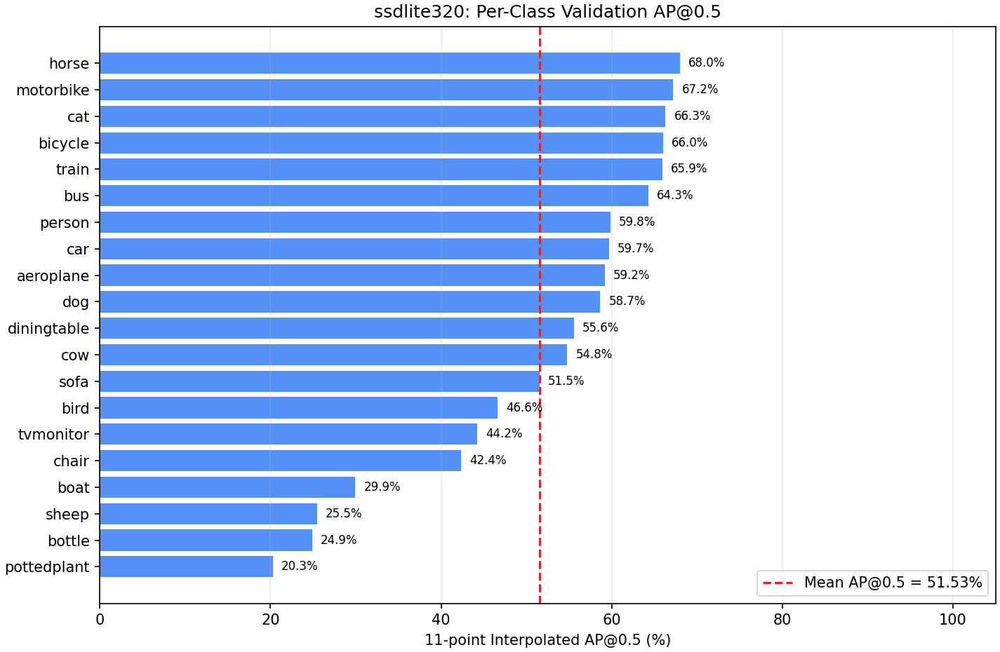

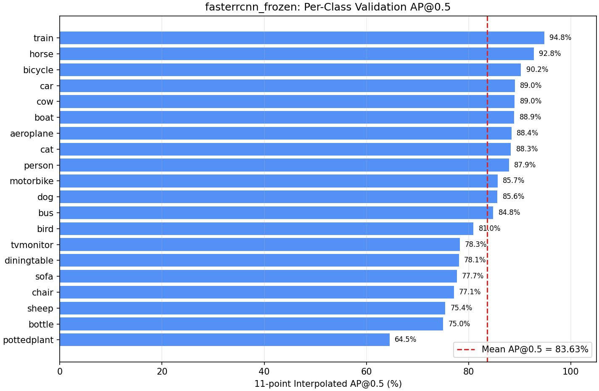

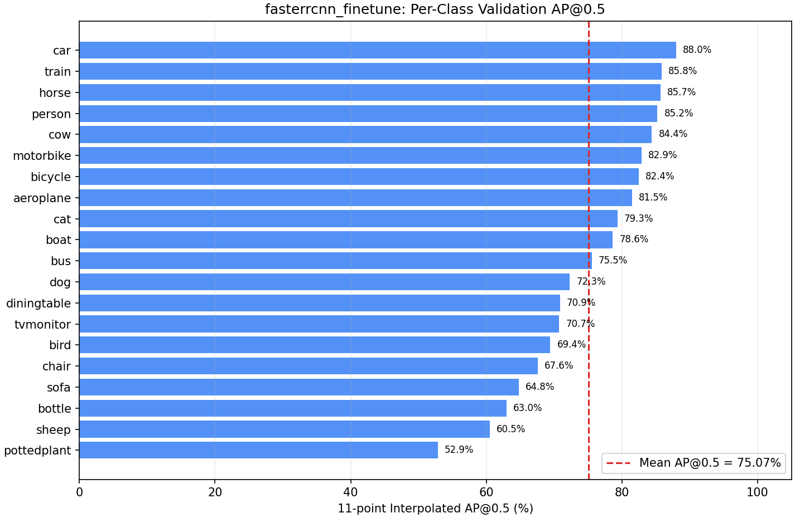

The complete 20-class comparison from [`outputs/a2_m2_a100/per_class_comparison.csv`](outputs/a2_m2_a100/per_class_comparison.csv) is reported below:

| Class ID | Class Name | Val GT Boxes (`diff=0`) | `ssdlite320` AP@0.5 | `fasterrcnn_frozen` AP@0.5 | `fasterrcnn_finetune` AP@0.5 | Gain: `frozen` vs. `ssdlite320` | Diff: `finetune` vs. `frozen` |
|---:|---|---:|---:|---:|---:|---:|---:|
| 1 | `aeroplane` | 69 | 59.17% | **88.42%** | 81.50% | +29.25 pp | -6.92 pp |
| 2 | `bicycle` | 84 | 66.00% | **90.24%** | 82.44% | +24.24 pp | -7.80 pp |
| 3 | `bird` | 98 | 46.59% | **80.95%** | 69.44% | +34.36 pp | -11.52 pp |
| 4 | `boat` | 67 | 29.93% | **88.93%** | 78.63% | **+59.00 pp** | -10.31 pp |
| 5 | `bottle` | 97 | 24.89% | **75.02%** | 62.97% | **+50.13 pp** | -12.06 pp |
| 6 | `bus` | 42 | 64.27% | **84.82%** | 75.54% | +20.54 pp | -9.27 pp |
| 7 | `car` | 262 | 59.68% | **89.04%** | 87.98% | +29.36 pp | -1.06 pp |
| 8 | `cat` | 75 | 66.31% | **88.27%** | 79.33% | +21.96 pp | -8.94 pp |
| 9 | `chair` | 166 | 42.36% | **77.11%** | 67.56% | +34.75 pp | -9.55 pp |
| 10 | `cow` | 55 | 54.80% | **89.02%** | 84.41% | +34.22 pp | -4.60 pp |
| 11 | `diningtable` | 42 | 55.57% | **78.11%** | 70.86% | +22.54 pp | -7.25 pp |
| 12 | `dog` | 97 | 58.66% | **85.63%** | 72.29% | +26.97 pp | -13.34 pp |
| 13 | `horse` | 69 | 67.99% | **92.76%** | 85.66% | +24.77 pp | -7.10 pp |
| 14 | `motorbike` | 63 | 67.21% | **85.66%** | 82.86% | +18.45 pp | -2.80 pp |
| 15 | `person` | 942 | 59.83% | **87.92%** | 85.23% | +28.09 pp | -2.69 pp |
| 16 | `pottedplant` | 140 | 20.28% | **64.55%** | 52.85% | **+44.26 pp** | -11.70 pp |
| 17 | `sheep` | 52 | 25.48% | **75.41%** | 60.52% | **+49.93 pp** | -14.89 pp |
| 18 | `sofa` | 47 | 51.53% | **77.68%** | 64.77% | +26.15 pp | -12.90 pp |
| 19 | `train` | 61 | 65.94% | **94.81%** | 85.85% | +28.87 pp | -8.96 pp |
| 20 | `tvmonitor` | 64 | 44.20% | **78.28%** | 70.73% | +34.08 pp | -7.56 pp |
| — | **Mean (mAP@0.5)** | **2,592** | **51.53%** | **83.63%** | **75.07%** | **+32.10 pp** | **-8.56 pp** |

**Class-Level Observations:**
- **`fasterrcnn_frozen` wins all 20 classes:** Its strongest categories are `train` (`94.81%`), `horse` (`92.76%`), `bicycle` (`90.24%`), `car` (`89.04%`), `cow` (`89.02%`), `boat` (`88.93%`), and `aeroplane` (`88.42%`).
- **Largest gains over `ssdlite320` occur on small/clustered categories:** Consistent with our EDA hypothesis, the largest improvements of `fasterrcnn_frozen` over `ssdlite320` are on `boat` (`+59.00 pp`, from `29.93%` to `88.93%`), `bottle` (`+50.13 pp`, from `24.89%` to `75.02%`), `sheep` (`+49.93 pp`, from `25.48%` to `75.41%`), and `pottedplant` (`+44.26 pp`, from `20.28%` to `64.55%`)—categories characterized by small relative bounding-box areas and multi-instance clustering.
- **Most challenging category across all models:** `pottedplant` has the lowest AP across all three models (`20.28%`, `64.55%`, `52.85%`), followed by `bottle` (`24.89%`, `75.02%`, `62.97%`) and `chair` (`42.36%`, `77.11%`, `67.56%`). As noted in our EDA, `chair` (`124` difficult val boxes) and `pottedplant` have high rates of occlusion, ambiguous boundaries (pot vs. foliage), and indoor clutter.
- **Where `fasterrcnn_finetune` loses the most vs. `fasterrcnn_frozen`:** For high-sample classes (`person` with `3,748` train boxes and `car` with `988` train boxes), `fasterrcnn_finetune` nearly matches `fasterrcnn_frozen` (`-2.69 pp` on `person`, `-1.06 pp` on `car`). By contrast, on classes with fewer training examples or finer-grained textures (`sheep` `-14.89 pp`, `dog` `-13.34 pp`, `sofa` `-12.90 pp`, `bottle` `-12.06 pp`, `pottedplant` `-11.70 pp`, `bird` `-11.52 pp`), unfreezing the backbone causes substantial degradation because there are too few VOC samples in those categories to re-stabilize 41.4M parameters after early high-LR drift.

### 3.4. Error Taxonomy and Qualitative Detection Analysis

To look beyond aggregate mAP, [`a2/voc_eval.py`](a2/voc_eval.py) categorizes every validation prediction with confidence $\hat{s}_i \ge 0.30$ against the `2,592` non-difficult ground-truth boxes into five mutually exclusive outcomes (`correct`, `wrong_class`, `localization_error`, `duplicate`, `background_fp`) and counts all missed non-difficult ground-truth objects (`missed_gt`) stratified by object size (`small`, `medium`, `large`):

| Error / Outcome Category ($\hat{s} \ge 0.30$) | Definition | `ssdlite320` | `fasterrcnn_frozen` | `fasterrcnn_finetune` |
|---|---|---:|---:|---:|
| **Correct Detections (TP)** | Same class, $\text{IoU} \ge 0.50$ with an unmatched non-difficult GT box | 1,391 (53.66% recall) | **2,389 (92.17% recall)** | 2,180 (84.10% recall) |
| **Missed GT Objects (FN Total)** | Non-difficult GT boxes with no matching TP prediction at $\hat{s} \ge 0.30$ | 1,201 (46.34% miss) | **203 (7.83% miss)** | 412 (15.90% miss) |
| ↳ *Missed Small GT (`<2%` area)* | Missed non-difficult GT boxes in the small bucket (`516` total in val) | **490 (94.96% missed)** | **83 (16.09% missed)** | 152 (29.46% missed) |
| ↳ *Missed Medium GT (`2–15%` area)* | Missed non-difficult GT boxes in the medium bucket (`981` total in val) | 525 (53.52% missed) | **89 (9.07% missed)** | 183 (18.65% missed) |
| ↳ *Missed Large GT (`>=15%` area)* | Missed non-difficult GT boxes in the large bucket (`1,095` total in val) | 186 (16.99% missed) | **31 (2.83% missed)** | 77 (7.03% missed) |
| **Wrong Class Error** | $\text{IoU} \ge 0.50$ with a GT box of a *different* class | 263 | **205** | 314 |
| **Localization Error** | Same class as GT box, but $0.10 \le \text{IoU} < 0.50$ | 452 | 806 | 639 |
| **Duplicate Detection** | Same class and $\text{IoU} \ge 0.50$ with an already-matched GT box | 99 | 171 | 134 |
| **Background False Positive** | $\text{IoU} < 0.10$ with all GT boxes | 235 | 546 | 436 |

Sources: [`ssdlite320/error_taxonomy.json`](outputs/a2_m2_a100/ssdlite320/error_taxonomy.json), [`fasterrcnn_frozen/error_taxonomy.json`](outputs/a2_m2_a100/fasterrcnn_frozen/error_taxonomy.json), and [`fasterrcnn_finetune/error_taxonomy.json`](outputs/a2_m2_a100/fasterrcnn_finetune/error_taxonomy.json).

**Diagnostic Error Insights:**
1. **Recall vs. Candidate Density Trade-Off:** At $\hat{s} \ge 0.30$, `ssdlite320` misses **`1,201` out of `2,592` ground-truth objects (`46.34%`)**, including **`490` of the `516` small validation objects (`94.96%` miss rate)**. By contrast, `fasterrcnn_frozen` detects **`2,389` of `2,592` objects (`92.17%` recall)** and reduces missed small objects by **$5.9\times$** (from `490` down to `83`). Because two-stage RPN+RoI detectors generate denser candidate boxes around objects (especially at lower scores $0.30 \le \hat{s} \le 0.50$), `fasterrcnn_frozen` exhibits more low-score localization/background candidates at the fixed `0.30` threshold (`806` localization, `546` background FPs), but ranks true positives at much higher confidence scores, yielding its `83.63%` mAP@0.5.
2. **Top Semantic Class Confusions (`wrong_class` pairs with $\text{IoU} \ge 0.50$):**
   - **`ssdlite320`:** `cow -> horse` (`16`), `cat -> dog` (`12`), `horse -> dog` (`11`), `chair -> sofa` (`10`), `motorbike -> bicycle` (`10`), `aeroplane -> bird` (`8`), `dog -> cat` (`8`), `sheep -> dog` (`8`).
   - **`fasterrcnn_frozen`:** `sofa -> chair` (`21`), `dog -> person` (`11`), `cat -> dog` (`10`), `dog -> cat` (`8`), `horse -> cow` (`8`), `sheep -> cow` (`7`), `car -> bus` (`6`), `chair -> diningtable` (`6`).
   - **`fasterrcnn_finetune`:** `sofa -> chair` (`17`), `dog -> cat` (`13`), `sheep -> dog` (`11`), `cat -> dog` (`10`), `chair -> sofa` (`10`), `cow -> sheep` (`10`), `horse -> dog` (`10`), `Aeroplane/boat -> bird` (`9` each).
   - Notice that across all three models, semantic confusions cluster within **visually and contextually related super-categories**: indoor furniture (`sofa <-> chair <-> diningtable`), four-legged domestic/farm animals (`cat <-> dog`, `cow <-> horse <-> sheep`), and road vehicles (`motorbike <-> bicycle`, `car <-> bus`). Furthermore, unfreezing the backbone (`fasterrcnn_finetune`) increases `wrong_class` errors by **`+53.17%`** over `fasterrcnn_frozen` (`314` vs. `205`), confirming that corrupting pretrained ResNet-50 features harms fine-grained semantic discrimination.

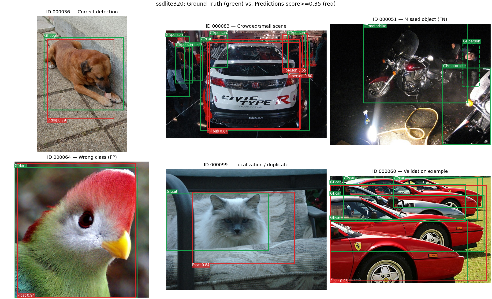

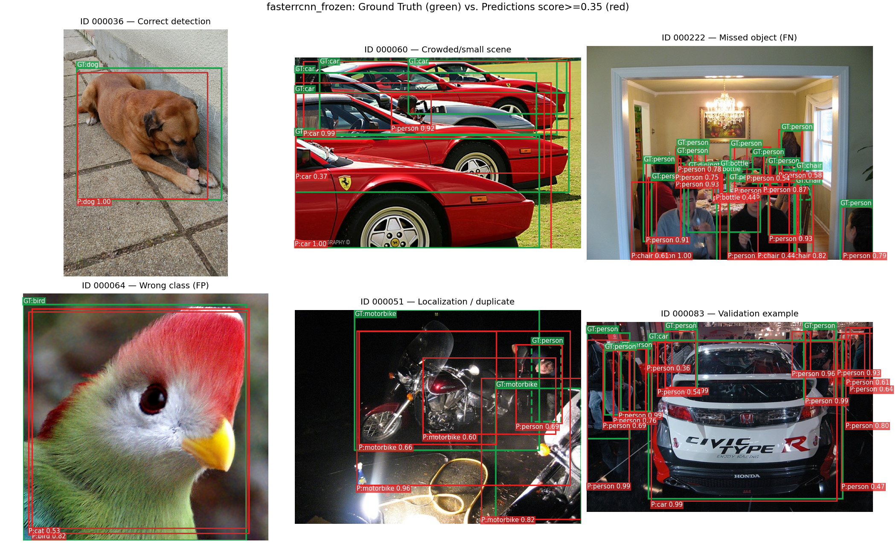

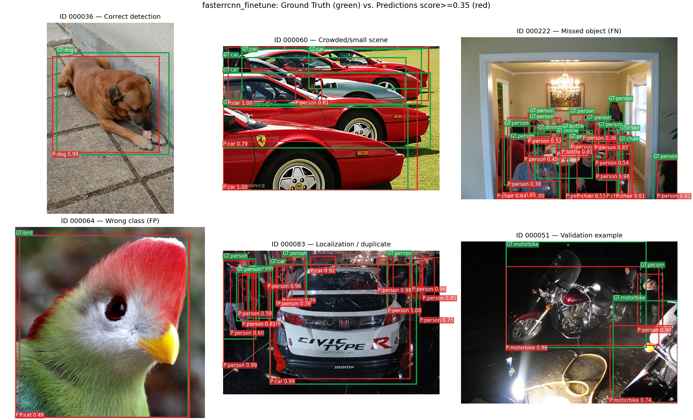

3. **Qualitative Visual Comparison (Figures 16–18):**
   - In the top rows (best validation scenes, e.g., multi-person indoor scenes `000017` and street/equestrian scenes `000109`), `fasterrcnn_frozen` (Figure 17) tightly localizes overlapping `person`, `horse`, and `car` instances with high confidence (`0.95`–`1.00`), whereas `ssdlite320` (Figure 16) produces looser boxes and lower confidence scores on smaller background instances.
   - In the bottom rows (hard failure cases, e.g., dense flocks/herds or cluttered indoor scenes with many small `bottle`/`pottedplant`/`chair` instances), `ssdlite320` misses nearly all small instances (red dashed GT boxes without green TP boxes), while `fasterrcnn_frozen` recovers most small objects but occasionally produces duplicate or partial-part boxes (`0.10 \le \text{IoU} < 0.50`, orange boxes) on heavily occluded chairs, sofas, and crowds.

### 3.5. Compute-Cost, Memory, and Latency Trade-Off Analysis

| Metric | `ssdlite320` | `fasterrcnn_frozen` | `fasterrcnn_finetune` | Ratio (`frozen` / `ssdlite320`) | Ratio (`finetune` / `frozen`) |
|---|---:|---:|---:|---:|---:|
| **Validation mAP@0.5** | 51.53% | **83.63%** | 75.07% | **+32.10 pp (1.62×)** | -8.56 pp (0.90×) |
| **Total Parameters** | **4,026,740** | 41,396,536 | 41,396,536 | 10.28× | 1.00× |
| **Trainable Parameters** | **4,026,740** | 17,941,624 | 41,396,536 | 4.46× | 2.31× |
| **Total Training Time (s)** | **832.30** | 1,320.33 | 1,807.59 | 1.59× | 1.37× |
| **Mean Train Epoch Time (s)** | **41.62** | 110.03 | 150.63 | 2.64× | 1.37× |
| **Mean Validation Epoch Time (s)** | **11.94** | 19.93 | 19.76 | 1.67× | 0.99× |
| **Single-Image Latency (`B=1`, ms)** | **16.62** | 29.28 | 22.03 | 1.76× | 0.75× |
| **Inference Throughput (`B=1`, FPS)** | **60.17** | 34.15 | 45.40 | 0.57× | 1.33× |
| **Peak Training VRAM (MB)** | **462.8** | 1,265.7 | 3,612.6 | 2.74× | **2.85×** |

**Engineering Trade-Off Discussion:**
1. **Accuracy vs. Edge Deployment Efficiency (`ssdlite320` vs. `fasterrcnn_frozen`):** `ssdlite320` requires **`10.28x` fewer total parameters** (`4.03M` vs. `41.40M`), **`2.74x` less training VRAM** (`462.8 MB` vs. `1,265.7 MB`), and achieves **`60.17 FPS`** (`16.62 ms/image`) vs. **`34.15 FPS`** (`29.28 ms/image`) on an A100 GPU. However, its `32.10` percentage-point deficit in `mAP@0.5`—and near-total inability to detect objects occupying $<2\%$ of the image (`2.29%` AP)—makes it suitable only for resource-constrained applications where target objects are guaranteed to be large and close to the camera.
2. **Pareto Dominance of `fasterrcnn_frozen` over `fasterrcnn_finetune`:** Between the two Faster R-CNN configurations under our fixed training protocol, `fasterrcnn_frozen` is **strictly Pareto-superior during training**: it achieves **`+8.56` pp higher `mAP@0.5`**, trains **`26.96%` faster** (`110.0 s/epoch` vs. `150.6 s/epoch`, because backward passes do not compute weight gradients through ResNet-50 `layer1`–`layer4`), and uses **`64.96%` less GPU memory** (`1,265.7 MB` vs. `3,612.6 MB`, as intermediate activations in the ResNet-50 body do not need to be cached for backpropagation). Note that at inference time (`batch_size = 1`), `fasterrcnn_finetune` exhibits a slightly shorter latency (`22.03 ms` vs. `29.28 ms`) simply because its lower confidence calibration produces fewer candidate proposals surviving RPN/NMS post-processing per image (`3,699` vs. `4,117` detections at $\hat{s} \ge 0.30$), not because the network architecture is smaller.

### 3.6. Implementation Verification, Provenance, and Reproducibility

- **Executed Notebook & Artifacts:** The complete execution log is preserved in [`notebooks/A2_Colab_Run.ipynb`](notebooks/A2_Colab_Run.ipynb), and all 37 output files are stored in [`outputs/a2_m2_a100/`](outputs/a2_m2_a100/). Provenance hashes and environment records are documented in [`COLAB_RUN_A2.md`](COLAB_RUN_A2.md).
- **Source & Split Fingerprints:**
  - `source_sha256`: `82d012d747c5aa0c2a80a0e70757ed84ff164c1ab7970c8d7cfab52bca3aaaa2`
  - `split_sha256`: `c60294fe4e914b27399ff065c9e246dcd3428440307c97cebf2febe139c2bd6c`
- **How to Reproduce on Google Colab (NVIDIA A100):**
  Open [`notebooks/A2_Colab_Run.ipynb`](notebooks/A2_Colab_Run.ipynb) in Google Colab with an A100 GPU runtime and run all cells from top to bottom, or execute via CLI:

~~~bash
python run_a2.py --stage eda --device cuda --data-root data/VOCdevkit/VOC2007 --out outputs/a2_m2_a100_rerun
python run_a2.py --stage pilot --device cuda --data-root data/VOCdevkit/VOC2007 --out outputs/a2_m2_a100_rerun
python run_a2.py --stage train --model all --device cuda --data-root data/VOCdevkit/VOC2007 --out outputs/a2_m2_a100_rerun
python run_a2.py --stage evaluate --model all --device cuda --data-root data/VOCdevkit/VOC2007 --out outputs/a2_m2_a100_rerun
~~~

### 3.7. Limitations, Risks, and Next Steps for Final Submission (M3)

1. **Current Limitations:**
   - **Single-Seed Evaluation:** All three models were trained and evaluated with a single random seed (`seed = 42`). Multi-seed variance has not been measured.
   - **Uniform Learning Rate Without Warmup in Full Fine-Tuning:** Our controlled experiment intentionally held the optimizer and learning rate schedule identical (`lr = 0.005`, no warmup) between `fasterrcnn_frozen` and `fasterrcnn_finetune` to isolate the effect of unfreezing the backbone. In practice, full fine-tuning with $B=2$ typically requires linear LR warmup (e.g., 500–1,000 steps) or differential learning rates (e.g., $10\times$ lower LR on the ResNet-50 backbone than on the new head) to prevent early feature drift.
   - **Small-Object Bottleneck in `ssdlite320`:** Fixed $320 \times 320$ resolution with horizontal flip augmentation alone is insufficient for small objects (`2.29%` AP@0.5); multi-scale crop/zoom-out augmentation (`SSDPhotometricDistort`, `RandomIoUCrop`) or a higher-resolution single-stage detector (e.g., RetinaNet / FCOS) is needed.
   - **Official Test Set Untouched:** In strict compliance with Handbook Section 4.2, the official VOC 2007 test set (`VOCtest_06-Nov-2007.tar`) has not been downloaded or evaluated in M2 (`test_evaluated = false`).
2. **Planned M3 Extensions:**
   - Add a second controlled ablation testing **linear LR warmup + differential backbone learning rate** on `fasterrcnn_finetune` to verify whether stabilizing early gradients allows full fine-tuning to match or exceed `fasterrcnn_frozen`.
   - Evaluate the locked final checkpoints once on the official VOC 2007 test set (`4,952` images) for M3 final reporting, and prepare the presentation slides and 12–15 minute YouTube video walkthrough.

---

## AI Usage Disclosure

The team used AI tools to assist with pipeline structuring, code verification, and technical report editing. All experiments, 200-step pilots, and checkpoint evaluations were executed on Google Colab with an **NVIDIA A100-SXM4-40GB GPU**, and every number in this report is verified against the saved artifacts in `outputs/a2_m2_a100/` and `outputs/a2_eda/20261006T225426_686818Z/`. Full disclosure records are provided in [AI_USAGE.md](AI_USAGE.md).

## References

1. M. Everingham, L. Van Gool, C. K. I. Williams, J. Winn, and A. Zisserman, "The PASCAL Visual Object Classes (VOC) Challenge," *International Journal of Computer Vision (IJCV)*, vol. 88, no. 2, pp. 303–338, 2010. [PASCAL VOC 2007 Website](http://host.robots.ox.ac.uk/pascal/VOC/voc2007/).
2. S. Ren, K. He, R. Girshick, and J. Sun, "Faster R-CNN: Towards Real-Time Object Detection with Region Proposal Networks," in *Advances in Neural Information Processing Systems (NeurIPS)*, 2015.
3. T.-Y. Lin, P. Dollár, R. Girshick, K. He, B. Hariharan, and S. Belongie, "Feature Pyramid Networks for Object Detection," in *Proceedings of the IEEE Conference on Computer Vision and Pattern Recognition (CVPR)*, 2017.
4. A. Howard *et al.*, "Searching for MobileNetV3," in *Proceedings of the IEEE/CVF International Conference on Computer Vision (ICCV)*, 2019 (including SSDLite320 MobileNetV3-Large).
5. Course Project Handbook CO3133, Semester 261, Ho Chi Minh City University of Technology (HCMUT), VNU-HCM; Sections 3, 4.2, 5, 7 and Part III (Sections 15–23).
