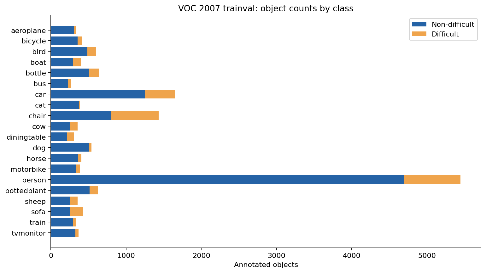
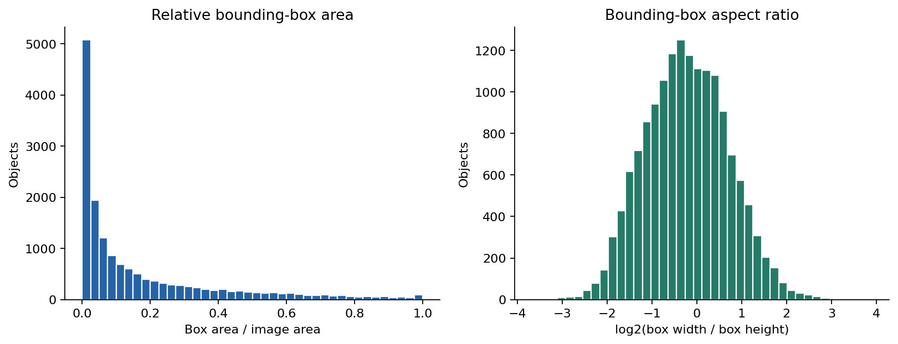
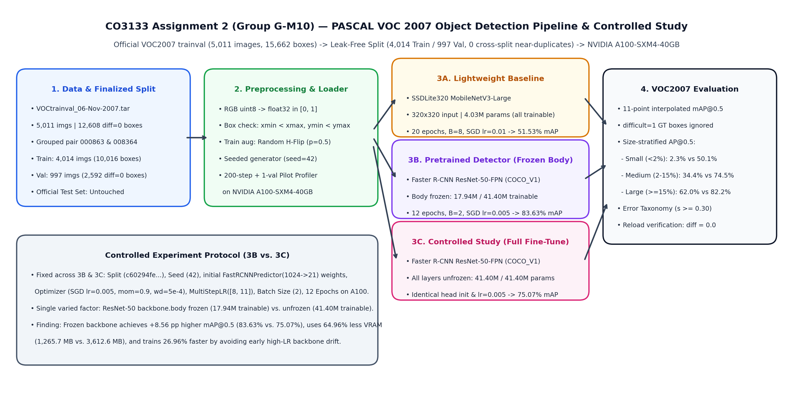
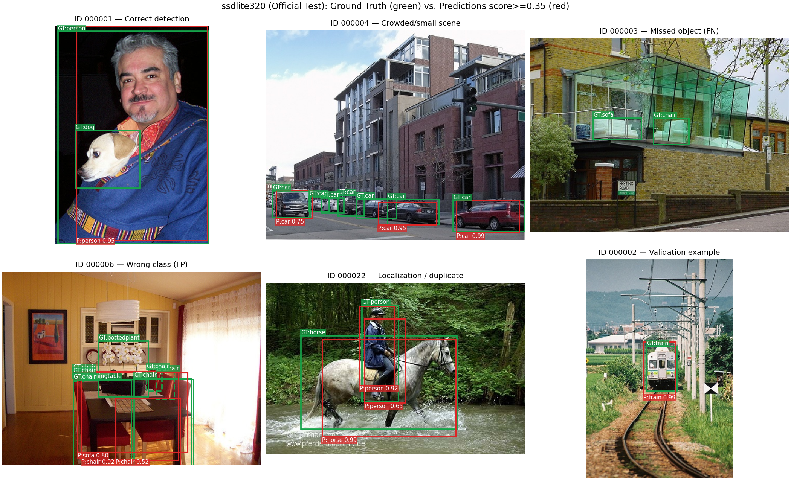
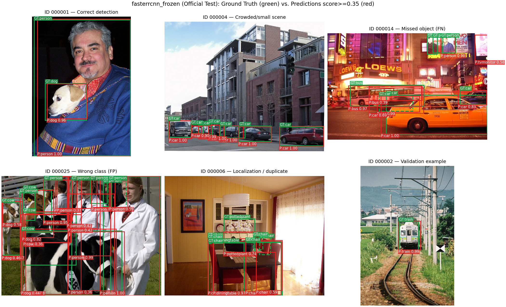

# Assignment 2 - M3 Final Report: Object Detection on PASCAL VOC 2007

**Deep Learning on Large-Scale Data for Specialized Computer Vision Tasks**

**University:** Ho Chi Minh City University of Technology (HCMUT), VNU-HCM  
**Faculty:** Faculty of Computer Science and Engineering  
**Course:** CO3133 - Deep Learning and Its Applications, Semester 261  
**Instructor:** Lê Thành Sách  
**Group:** G-M10

| Member | Student ID | Role | M3 Final Responsibilities |
|---|---|---|---|
| Trần Gia Lâm | 2352670 | Leader | Faster R-CNN ResNet-50-FPN & controlled study (frozen vs. fine-tune), experiment protocol, error taxonomy, report & slide integration |
| Nguyễn Hữu Cầu | 2352129 | Member | PASCAL VOC 2007 EDA, near-duplicate audit & finalized split (`4,014/997`), SSDLite320 baseline, shared VOC evaluator, Official Test Set evaluation & M3 submission |

**Supporting Deliverables:**
- **Final PDF Report (LMS):** [`output/pdf/G-M10_A2_Report.pdf`](output/pdf/G-M10_A2_Report.pdf)
- **Presentation Slides:** [`output/presentation/G-M10_A2_Slides.pdf`](output/presentation/G-M10_A2_Slides.pdf)
- **YouTube Video:** `[TODO: Insert YouTube URL after recording]` (Title: `CO3133-Semester-261 - Group G-M10 - Assignment 2`)
- **Checkpoints (Google Drive):** Backed up to Google Drive (`CO3133_A2_M3_Checkpoints`: `ssdlite320_best.pt`, `fasterrcnn_frozen_best.pt`, `fasterrcnn_finetune_best.pt`)
- **Executed Colab Notebook:** [`notebooks/A2_M3_Colab_Run.ipynb`](notebooks/A2_M3_Colab_Run.ipynb)
- **M1 Proposal & M2 Draft Archives:** [`../a2_m1/`](../a2_m1/) · [`../a2_m2/`](../a2_m2/)

---

## Part 1. Problem Formulation, Dataset Proposal & Task-Specific EDA

### 1.1. Problem Statement
Given an arbitrary-resolution RGB photograph $I \in [0, 1]^{3 \times H \times W}$, the detector predicts a variable-length set of candidate detections $\hat{\mathcal{Y}} = \{(\hat{\mathbf{b}}_i, \hat{c}_i, \hat{s}_i)\}_{i=1}^{N}$, where $\hat{\mathbf{b}}_i = (x_{\min,i}, y_{\min,i}, x_{\max,i}, y_{\max,i})$ is the bounding box, $\hat{c}_i \in \{1,\dots,20\}$ is the foreground class label (`0` = background), and $\hat{s}_i \in [0,1]$ is the confidence score.

### 1.2. Dataset, Finalized Leak-Free Split & TrainVal-vs-Test Overlap Audit
- **Trainval Archive:** `VOCtrainval_06-Nov-2007.tar` (MD5 `c52e279531787c972589f7e41ab4ae64`, `5,011` images, `15,662` boxes: `12,608` non-difficult + `3,054` `difficult=1`).
- **Official Test Archive:** `VOCtest_06-Nov-2007.tar` (MD5 `b6e924de25625d8de591ea690078ad9f`, `4,952` images, `14,976` boxes: `12,032` non-difficult + `2,944` `difficult=1` ignored).
- **Near-Duplicate Resolution:** Near-duplicate pair `000863` / `008364` (`dHash = 3`) was grouped into `train` prior to training (`split_sha256 = c60294fe4e914b27399ff065c9e246dcd3428440307c97cebf2febe139c2bd6c`).
- **Trainval-vs-Test Overlap Audit ([`outputs/a2_m3_a100/test_overlap_check.json`](outputs/a2_m3_a100/test_overlap_check.json)):** `0` image ID overlaps, `0` exact SHA-256 overlaps, and `59` low-variance perceptual hash collisions ($\text{dHash} \le 4$, primarily uniform sky/horizon backgrounds such as `003183`).

| Partition | Images | Total Boxes | Non-Difficult (`diff=0`) | Difficult (`diff=1`) | Leakage Status |
|---|---:|---:|---:|---:|---|
| Training (`splits/train.txt`) | 4,014 | 12,451 | 10,016 | 2,435 | 0 cross-split duplicates |
| Validation (`splits/val.txt`) | 997 | 3,211 | 2,592 | 619 (ignored) | 0 cross-split duplicates |
| **Official Test (`test.txt`)** | **4,952** | **14,976** | **12,032** | **2,944 (ignored)** | **0 ID / 0 SHA-256 overlap** |

### 1.3. Task-Specific EDA Highlights

1. **Class Imbalance ($22.02 : 1$):** `person` (`4,690` non-difficult boxes) vs. `bus` (`213`), `diningtable` (`215`), `sofa` (`248`), `sheep` (`257`), while `mAP@0.5` weights all 20 classes equally.
2. **Small-Object Bottleneck:** Across `12,608` non-difficult boxes, **`20.60%` (`2,597`) are small (`<2%` image area)**, `37.93%` are medium (`2–15%`), and `41.47%` are large (`>=15%`). We hypothesize `SSDLite320` ($320 \times 320$) will collapse on small objects while `Faster R-CNN ResNet-50-FPN` (`640–1000 px` + FPN `P2–P6`) will preserve small-object recall.

---

## Part 2. Methodology & Controlled Experiment Design

| Model ID | Architecture | Backbone / Pretraining | Trainable / Total Params | Batch / Epochs | Optimizer & Schedule |
|---|---|---|---|---|---|
| `ssdlite320` | Single-stage `SSDLite320` ($320 \times 320$) | MobileNetV3-Large (`IMAGENET1K_V1`) | 4,026,740 / 4,026,740 | `8` / `20` | SGD `lr=0.01`, `MultiStepLR([12,16])` |
| `fasterrcnn_frozen` | Two-stage `Faster R-CNN` (`640–1000 px`) | ResNet-50-FPN (`COCO_V1`, **body frozen**) | 17,941,624 / 41,396,536 | `2` / `12` | SGD `lr=0.005`, `MultiStepLR([8,11])` |
| `fasterrcnn_finetune` | Two-stage `Faster R-CNN` (`640–1000 px`) | ResNet-50-FPN (`COCO_V1`, **all trainable**) | 41,396,536 / 41,396,536 | `2` / `12` | SGD `lr=0.005`, `MultiStepLR([8,11])` |

- **Controlled Study (`fasterrcnn_frozen` vs. `fasterrcnn_finetune`):** Fixed split (`c60294fe...`), `seed = 42`, identical newly initialized `FastRCNNPredictor(1024 -> 21)` weights, batch size `2`, and SGD `lr = 0.005` without warmup; single varied factor is freezing `backbone.body` (`23,454,912` params).

---

## Part 3. Experimental Results: Validation & Official Test Evaluation

### 3.1. Validation Results (M3 NVIDIA L4 Run `outputs/a2_m3_a100/`)

| Model | Best Epoch | Val mAP@0.5 | Small AP (`<2%`) | Med AP (`2–15%`) | Large AP (`>=15%`) | Train Time (s) | Latency (`B=1`) | Peak VRAM |
|---|---:|---:|---:|---:|---:|---:|---:|---:|
| `ssdlite320` | 17 / 20 | **50.70%** | 1.85% | 34.60% | 63.29% | 829.4 s | 16.22 ms (`61.7 FPS`) | 462.8 MB |
| `fasterrcnn_frozen` | 11 / 12 | **83.58%** | **50.10%** | **74.36%** | **81.71%** | 2,425.1 s | 31.34 ms (`31.9 FPS`) | 1,266.2 MB |
| `fasterrcnn_finetune` | 12 / 12 | **75.51%** | 42.50% | 62.19% | 75.22% | 3,926.0 s | 30.79 ms (`32.5 FPS`) | 3,612.2 MB |

### 3.2. Official VOC 2007 Test Set Evaluation (Single-Shot — `outputs/a2_m3_a100/`)

Checkpoints were selected strictly by Validation `mAP@0.5` before touching the Official Test Set (`4,952` images, `12,032` non-difficult objects).

| Model | Selected Epoch | Val mAP@0.5 | **Official Test mAP@0.5** | Delta (Test − Val) | Test Small AP | Test Med AP | Test Large AP |
|---|---:|---:|---:|---:|---:|---:|---:|
| `ssdlite320` | 17 | 50.70% | **52.98%** | +2.28 pp | 0.79% | 32.75% | 64.98% |
| `fasterrcnn_frozen` | 11 | **83.58%** | **83.65%** | +0.07 pp | **45.32%** | **75.15%** | **81.89%** |
| `fasterrcnn_finetune` | 12 | 75.51% | **76.90%** | +1.40 pp | 32.89% | 63.46% | 76.36% |

### 3.3. Official Test Error Taxonomy & Qualitative Analysis (`score >= 0.30`)

| Outcome / Error Category (12,032 Test GT) | `ssdlite320` | `fasterrcnn_frozen` | `fasterrcnn_finetune` |
|---|---:|---:|---:|
| **Correct Detections (TP)** | 6,661 (55.36%) | **11,143 (92.61%)** | 10,108 (84.01%) |
| **Missed GT Objects (FN Total)** | 5,371 (44.64%) | **889 (7.39%)** | 1,924 (15.99%) |
| ↳ *Missed Small GT (`<2%` area)* | 2,151 | **367** | 750 |
| **Wrong Class Error (`IoU >= 0.50`)** | 1,133 | **938** | 1,242 |
| **Localization Error (`0.10 <= IoU < 0.50`)** | 1,981 | 3,952 | 2,517 |
| **Duplicate Detection** | 494 | 814 | 538 |
| **Background False Positive (`IoU < 0.10`)** | 1,031 | 2,840 | 1,713 |

### 3.4. Limitations & Conclusion
- **Limitations:** Single-seed evaluation (`seed=42`); uniform LR `0.005` without warmup for `fasterrcnn_finetune`; fixed $320 \times 320$ resolution bottleneck in `ssdlite320`.
- **Conclusion:** Freezing the pretrained `COCO_V1` ResNet-50 backbone while training the FPN, RPN, and 21-class RoI heads achieves **`83.65%` Official Test mAP@0.5** (`92.61%` recall at `score >= 0.30`), outperforming `ssdlite320` by `+30.67` pp and full fine-tuning by `+6.75` pp while saving `64.95%` peak training VRAM.

---

## AI Usage Disclosure
Detailed disclosure is recorded in [`AI_USAGE.md`](AI_USAGE.md) and [`../../AI_USAGE.md`](../../AI_USAGE.md).
