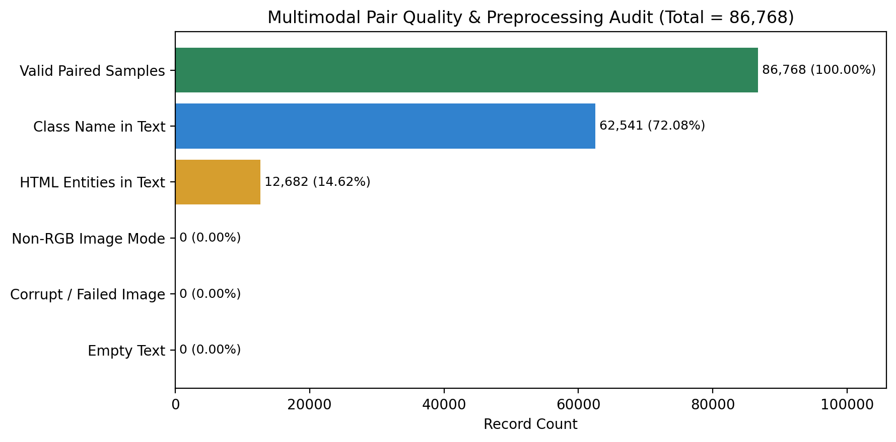
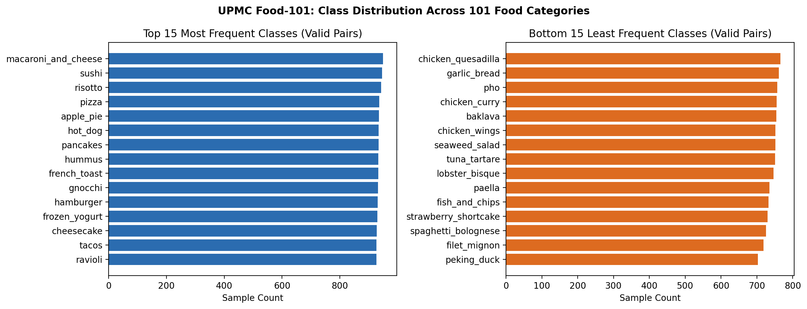
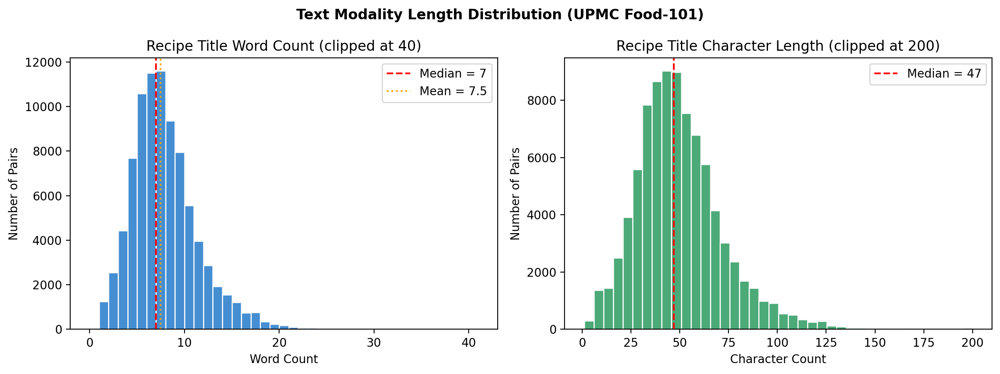
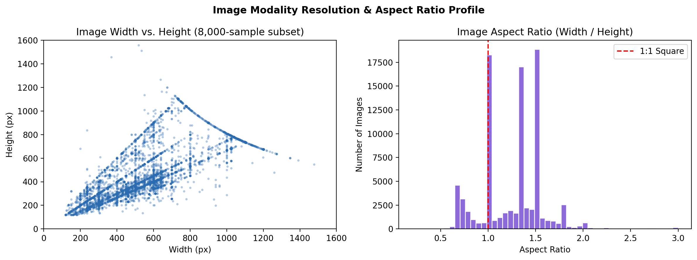
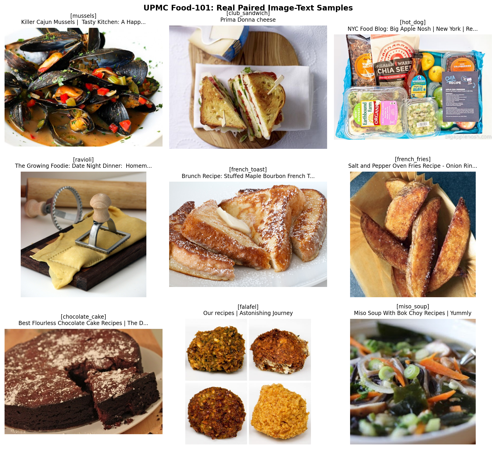
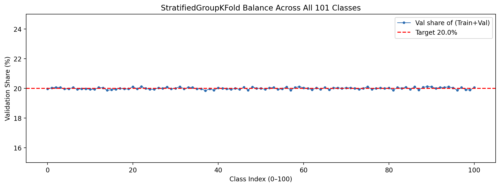
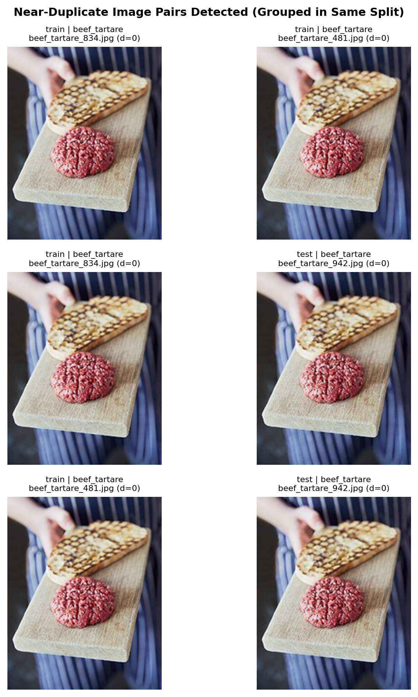

# Assignment 3 - Multimodal Deep Learning
### Multimodal Deep Learning: Representation, Fusion, and Evaluation

**Group:** G-M10  
**Members:** Trần Gia Lâm (2352670) [Leader], Nguyễn Hữu Cầu (2352129) [Member]  
**Instructor:** Lê Thành Sách  
**Course:** CO3133 - Deep Learning and Its Applications, Semester-261 (HCMUT)  
**Task:** Image–Text Multimodal Classification (101 Food Categories)  
**Submission Milestone:** M1 — Dataset Proposal (Due: 18/11/2026, 23:59 GMT+7)

---

## 1. Problem Statement
Multimodal food recognition combines visual appearance (food dish image) with noisy web metadata (recipe webpage title) to classify dishes into **101 food categories**. Visual-only models struggle with visually similar dishes (e.g., *ramen* vs. *pho*, *chocolate_mousse* vs. *tiramisu*) or occluded/non-standard plating, while text-only models struggle when recipe titles are generic, truncated, contain HTML entities, or omit the dish name (~27.92% of samples). This project investigates unimodal baselines alongside simple and improved multimodal fusion architectures under a leakage-controlled evaluation protocol.

---

## 2. Dataset Proposal & Approval Status
- **Status:** M1 Proposal Submitted (Pending Instructor Approval — *Approved / Approved with conditions / Rejected*).
- **Dataset Name:** UPMC Food-101 (Wang et al., ICMEW 2015)
- **Source & Version:** Hugging Face Hub mirror [`kkim0451/UPMC-Food101`](https://huggingface.co/datasets/kkim0451/UPMC-Food101), v1.0 (`UPMC-Food-101.zip`, 8,268,462,033 bytes).
- **License:** Hugging Face repository declares `apache-2.0` for dataset packaging; underlying web-collected recipe images and titles are used strictly for academic, non-commercial research.
- **Task & Modalities:**
  - **Task:** Single-label multi-class Image–Text Classification (**101 classes**).
  - **Modalities:** Image (RGB JPEG) + Text (English recipe webpage title).
  - **Input:** Paired `(Image, Recipe Title)` from the same recipe webpage (`recipe_id`).
  - **Output:** 101-class probability distribution $\hat{y} \in \Delta^{100}$.
- **Handbook Section 28.2 Threshold Compliance:**
  - Classes: **101** (requirement: $\ge 5$).
  - Valid paired samples: **86,768** (65,085 official train + 21,683 official test; requirement: $\ge 5,000$).
  - Cross-modal validity: Every sample pairs an image and webpage title extracted from the exact same recipe page (`id`).

---

## 3. Dataset Description, Multimodal EDA & Split Plan
All statistics below are computed directly from the executed EDA pipeline ([`notebooks/A3_EDA_Proposal.ipynb`](notebooks/A3_EDA_Proposal.ipynb)) and stored in [`outputs/a3_eda/summary.json`](outputs/a3_eda/summary.json) and [`outputs/a3_eda/quality_checks.json`](outputs/a3_eda/quality_checks.json).

### 3.1 Pair-Quality & Modality Audit (Handbook Section 31)
| Metric | Observed Value | Notes / Preprocessing Action |
|---|---:|---|
| Total raw records | **86,768** | 65,085 official train + 21,683 official test |
| Valid paired samples | **86,768 (100.00%)** | 0 missing/corrupt images, 0 empty texts |
| Failed / missing images | **0 (0.00%)** | Verified via full PIL `Image.open().load()` |
| Non-RGB images | **0 (0.00%)** | All 86,768 images are RGB |
| Image width (min / median / p90 / max) | **120 / 500 / 1,039 / 2,000 px** | Standardize to `224×224` (or `256→224` crop) |
| Image height (min / median / p90 / max) | **120 / 399 / 779 / 2,960 px** | Aspect ratios centered near 1.0–1.33 |
| Word count (min / p10 / median / mean / p90 / max) | **0 / 4 / 7 / 7.50 / 12 / 155** | Max token length `64` covers >99% of titles |
| HTML entities in text (`&#8217;`, `&raquo;`, etc.) | **14.62%** | Apply `html.unescape()` before tokenization |
| Exact class phrase present in title | **72.08%** | 27.92% lack explicit class name (require vision/context) |
| Unique clean titles | **60,657** | Boilerplate/artifact titles exist (e.g., `#NAME?` × 235) |
| Exact SHA-256 duplicate image groups | **2,491** | Grouped before splitting |
| Near-duplicate image pairs (dHash dist $\le 3$) | **11,698** | Grouped before splitting |

### 3.2 Split Plan & Leakage-Prevention Unit (Handbook Sections 27 & 28.1)
- **Leakage-Prevention Unit:** **`recipe_id`** (`id`, pairing image and title from the same webpage), further clustered by **exact SHA-256 hash** and **perceptual dHash (Hamming distance $\le 3$)** using Union-Find so duplicate/near-duplicate images never straddle `train` and `val`.
- **Split Method:** `StratifiedGroupKFold` (`n_splits=5`, `random_state=42`) on the 65,085 official train pairs, yielding an 80/20 split:
  - **Train:** **52,068** samples (101 classes, saved in [`outputs/a3_eda/splits/train.csv`](outputs/a3_eda/splits/train.csv))
  - **Validation:** **13,017** samples (101 classes, saved in [`outputs/a3_eda/splits/val.csv`](outputs/a3_eda/splits/val.csv))
  - **Test (Official):** **21,683** samples (101 classes, saved in [`outputs/a3_eda/splits/test.csv`](outputs/a3_eda/splits/test.csv))
- **Leakage Audit Results:**
  - `train` vs. `val` exact SHA-256 overlap: **0**; near-duplicate overlap: **0**.
  - Validation share per class ranges tightly from **19.85%** to **20.12%** across all 101 classes.
  - Class sizes overall range from **703** (*peking_duck*) to **950** (*macaroni_and_cheese*) (1.35× ratio).
  - **Official Test Overlap Finding:** Auditing official `test` against `train+val` revealed **1,018** exact SHA-256 overlaps (825 train–test, 193 val–test) and **4,395** near-duplicate pairs. In M2/M3, we will report metrics on **both** the full official test set (21,683) and a **de-duplicated clean test subset** excluding overlapping hashes.

---

## 4. Planned Methodology, Baselines & Evaluation (Handbook Section 29)

### 4.1 Evaluation Metrics (Section 29.3)
- **Primary Metrics:** **Top-1 Accuracy** and **Macro-F1** (101 classes).
- **Secondary Metric:** **Top-5 Accuracy** (to evaluate fine-grained food confusion).

### 4.2 Four Mandatory Models (Section 29.1 & 29.2)
All models share identical `train` / `val` / `test` splits, preprocessing (`html.unescape()`, RGB `224×224`), random seed (`42`), and AdamW + Cosine Annealing schedule:
1. **Unimodal A (Image-Only Baseline):** `ConvNeXt-Tiny` (ImageNet-1K pretrained) + linear classification head, trained with Cross-Entropy loss ($\mathcal{L}_{\text{img}}$).
2. **Unimodal B (Text-Only Baseline):** `DistilBERT-base-uncased` on cleaned recipe titles (`max_len=64`) + `[CLS]` linear head, trained with Cross-Entropy loss ($\mathcal{L}_{\text{txt}}$).
3. **Simple Fusion Baseline:** Dual-encoder concatenation (`ConvNeXt-Tiny` 768-d pooled feature $\oplus$ `DistilBERT` 768-d `[CLS]` feature $\rightarrow$ 1536-d $\rightarrow$ LayerNorm + Dropout + MLP classifier), trained end-to-end with joint Cross-Entropy loss.
4. **Improved Multimodal Model:** **Gated Multimodal Fusion with Cross-Modal Attention & Modality Dropout** — projects image patch tokens and text token embeddings into a shared 512-d space, applies bidirectional cross-attention + learnable modality gate $g = \sigma(W_g [h_v; h_t])$, auxiliary unimodal regularization losses ($\mathcal{L} = \mathcal{L}_{\text{mm}} + 0.2\,\mathcal{L}_{\text{img}} + 0.2\,\mathcal{L}_{\text{txt}}$), and **modality dropout ($p=0.15$)** during training so the model remains robust when text is noisy (`#NAME?`) or images are occluded.

### 4.3 Planned Ablation & Error Analysis (Section 29.2 & 30)
- **Ablation 1 (Modality Removal):** Image-only vs. Text-only vs. Simple Fusion vs. Improved Fusion.
- **Ablation 2 (Fusion Design):** Concatenation MLP vs. Gated Cross-Attention (with/without modality dropout & auxiliary unimodal losses).
- **Modality Interaction Analysis:** Categorize test predictions into **support cases** (both modalities agree or one resolves ambiguity) vs. **conflict cases** (e.g., misleading web title vs. clear dish image, or `#NAME?` / generic Pinterest title).

---

## 5. Compute Estimate & Subset Rules
- **Target Hardware:** Google Colab T4 GPU (16 GB VRAM, `torch.cuda.amp` FP16).
- **Estimated Training Cost:**
  - Unimodal Image (`ConvNeXt-Tiny`, 10 epochs, batch 64): ~2.5 GPU-hours.
  - Unimodal Text (`DistilBERT`, 6 epochs, batch 128): ~0.5 GPU-hours.
  - Simple Fusion (10 epochs, batch 64): ~3.0 GPU-hours.
  - Improved Multimodal + Ablations (2–3 runs × 10 epochs): ~6.0 GPU-hours.
  - **Total M2+M3 Budget:** **~12 GPU-hours** (fits comfortably within Colab free/Pro T4 sessions).
- **Subset Rules:** Full dataset (52,068 train / 13,017 val / 21,683 test) will be used for all 4 main models; rapid hyperparameter sanity checks may use a stratified 20% dev subset (`seed=42`) before full training.

---

## 6. Links & Artifacts
- **EDA Notebook:** [`notebooks/A3_EDA_Proposal.ipynb`](notebooks/A3_EDA_Proposal.ipynb)
- **Proposal PDF:** [`G-M10_A3_Proposal.pdf`](G-M10_A3_Proposal.pdf)
- **EDA Outputs:** [`outputs/a3_eda/summary.json`](outputs/a3_eda/summary.json), [`outputs/a3_eda/quality_checks.json`](outputs/a3_eda/quality_checks.json)
- **Source code / Checkpoints / Video:** *(To be updated in M2/M3)*

---

## 7. AI Usage Disclosure (Handbook Section 5.2)
- **Tools Used:** AI coding assistant (Antigravity / Gemini) was used to draft the EDA script/notebook (`A3_EDA_Proposal.ipynb`), structure `assignment3.md`, and format `G-M10_A3_Proposal.pdf`.
- **Human Verification:** All dataset downloads, 86,768 image/text integrity checks, SHA-256/dHash duplicate audits, `StratifiedGroupKFold` split generation, and figures were executed directly on the actual `UPMC-Food-101.zip` archive. Every reported number in this proposal was verified against `outputs/a3_eda/summary.json`, `quality_checks.json`, and `tables/*.csv`.
